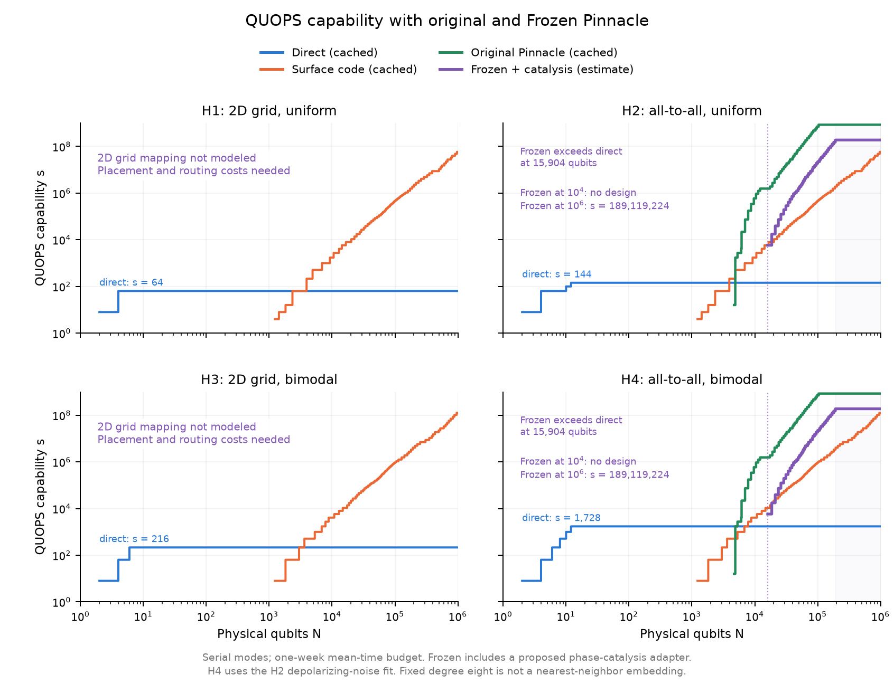

# Frozen Pinnacle QUOPS curve with phase catalysis

This is a separate, serial estimate for the fixed-connectivity architecture in
[Webster, Peham, and Cohen, arXiv:2609.21249v1](https://arxiv.org/html/2609.21249v1).
All prior models, results, and figures remain unchanged. Direct, surface-code,
and original Pinnacle curves in the new figure are cached references.

**The published Frozen engine supplies CCZ states for Toffolis, not a universal
T-state stream.** This curve therefore includes a proposed QUOPS adaptation:
phase catalysis from [Gidney and Fowler, arXiv:1812.01238v3, Section 4/Figure 14](https://arxiv.org/html/1812.01238v3).
It is labeled **Frozen + catalysis (estimate)**. The ideal catalytic identity is
tested, but its integration and catalyst-bootstrap layout have not been
compiled into a complete degree-eight hardware schedule. These estimates
should not be presented as a published Frozen QUOPS benchmark.

## Reproduction and files

From the repository root with the existing Python requirements installed:

```powershell
python scripts/make_frozen_pinnacle_curves.py
python -m pytest -q -p no:cacheprovider tests/test_frozen_pinnacle.py tests/test_phase_catalysis.py
```

`--skip-sensitivity` generates only the main comparison. New files are:

- `capability/frozen_pinnacle.py`: resource, time, error, and synthesis search.
- `scripts/make_frozen_pinnacle_curves.py`: independent comparison/sensitivity runner.
- `tests/test_frozen_pinnacle.py`: source parameters, arithmetic, optimization, and boundaries.
- `tests/test_phase_catalysis.py`: independent state-vector verification of the catalytic identity.
- `results/frozen_pinnacle.json` and `results/frozen_pinnacle_sensitivity.json`.
- `figures/quops_frozen_pinnacle.{png,pdf}` and `figures/frozen_pinnacle_sensitivity.{png,pdf}`.

The runner validates shared choices and hardware in `results/baseline.json`
and `results/pinnacle.json`, verifies the latter's baseline provenance, and
records both input SHA-256 values over canonical parsed JSON. The
`canonical-json-sha256-v1` format sorts keys and ignores line endings and
formatting; numeric changes still change the hash. It never reruns the reference models.
Sensitivity plots contain only the new Frozen model when shared choices change.

## 1. Published components and hardware

Use only the explicitly specified `[[510,16,24]]` Frozen code. Each block
provides **eight processing logical qubits**, with a second sector available
for optional memory. QUOPS stores its working qubits in processing sectors;
unused memory capacity is not counted as extra processing capacity.

| Component | Model value | Source |
|---|---:|---|
| Processing block | 2,522 physical qubits | Section V, Equation 3 accounting |
| Processing capacity per block | 8 logical qubits | Section III.1 |
| Native logical measurement | 30 code cycles | Sections III.1 and V |
| CCZ engine, including magic port | 7,855 physical qubits | Section V |
| CCZ output error | `2e-10` per state | Section III.3 |
| Engine reject probability | 0.01 | Section III.3 and Appendix A |
| Toffoli throughput | one per five logical cycles before rejection | Section III.3 |

The block footprint is `1020 + 9*99 + 101 + 10*51 = 2522`; it retains the
optional memory-sector gadget. The engine footprint is
`1020 + 4*99 + 3*101 + 12*454 + 8*29 + 3*(101+51) = 7855`.
Its three magic-port gadgets are already included and are not counted twice.

The source requires three dedicated magic-port logical ancillas on **three
different processing blocks**. The model enforces that minimum. Smaller code
variants are mentioned in the paper, but a complete lower-distance Frozen
engine/resource menu is not supplied; original Pinnacle's code footprints
are not silently substituted.

Fixed connectivity limits each qubit's set of interaction partners, but those
fixed edges may still span long distances. The four-class taxonomy has no
dedicated class for Frozen's native fixed-degree-eight graph; H2/H4 can supply
it, but their all-to-all connectivity is stronger than Frozen requires.
For H1/H3, a two-dimensional nearest-neighbor realization would need explicit
placement and routing, potentially adding SWAPs, ancillas, latency, and error.
Those costs are not modeled here. The missing H1/H3 curve is a modeling gap,
not a claim that such a realization is fundamentally impossible.
Both modeled classes use the source's fixed `p=1e-3` depolarizing-noise
parameters, with no assumed H4 bimodal gain. Other physical error rates are
not supported by this fixed fit/engine menu.

## 2. Mapping QUOPS to the CCZ engine

Reuse the existing QUOPS ensembles, the saved gridsynth fit, and shared
synthesis-error budget. For `R = w L_R` rotations and fitted integer T count
`t` per rotation, the T demand is `tau = R t`.

For a T angle, Figure 14 of the catalysis paper implements two T gates using
one Toffoli, one Clifford S, Clifford frame updates, a reusable T catalyst,
and a clean AND scratch. Because QUOPS widths are even, pair distinct-qubit
T gates within each rotation layer and synthesis round. Local Clifford
operations between T rounds can be tracked in the single unit's frame.
Thus there are `b = tau/2` catalytic batches, each consuming one CCZ state.

This pairing assumes the same fitted mean T count for each rotation, as in
the existing surface/Pinnacle estimates. It is not a compilation of every
random angle and its actual variable-length synthesis word.

Reserve five extra processing logicals: one catalyst, one scratch, and
three dedicated magic-port ancillas. With the published block footprint,

\[
\beta=\max\{3,\lceil(w+5)/8\rceil\},\qquad
N_{\rm copy}=2522\beta+7855+454+29.
\]

The last two terms are a **declared bootstrap adapter**, not extra published
Frozen hardware: a dedicated cultivated-state patch and an input bridge.
Its seed can enter an existing magic-port gadget, then teleport to a
dedicated catalyst logical; the port is reset before CCZ operation. Adding
that bridge leaves the port gadget with two bridges, consistent with the
paper's gadget limit. This check alone does not certify the complete wiring.
The adapter and transfer circuit still need an explicit layout.

## 3. Serial schedule and bootstrap

Let `D = max(30, reaction_cycles)`, with reaction time ten code cycles in
the baseline. Each batch uses five engine-dependent slots and two extra
serial slots for scratch preparation and X readout. The remaining Clifford
operations are frame updates. Extra batch slots are varied in sensitivity.

The catalyst is freshly seeded per execution from a cultivated T state of
error `2.7e-6`. Appendix A motivates an 18-round attempt and approximate
success probability 0.35. Six additional startup slots are allocated to
seed transfer, physical internal teleportation, and port reset; three more
account for initial CCZ-pipeline latency. These startup allocations are
declared schedule choices, not a published QUOPS bootstrap protocol.

For independent geometric CCZ waits `G_i` with success 0.99 and seed wait
`G_s` with success 0.35, both supported on `1,2,...`, define

\[
F=w+6+3+2b,\qquad
T_{\rm cycles}=D\left(F+5\sum_{i=1}^{b}G_i\right)+18G_s.
\]

Consequently

\[
\mathbb E[T]=t_c\left[D\left(F+\frac{5b}{0.99}\right)+\frac{18}{0.35}\right].
\]

Rejected CCZ preparations are resolved before catalytic consumption, so
they stall the computation without using or poisoning the catalyst. The
engine may pause its pipeline during scratch operations; storage exposure
for the paused engine is charged separately below. No circuit-wide restart
is added for an internal rejection.

## 4. Fault and synthesis accounting

Equation 1 and Table 2 give per-block component fits at `p=1e-3`. Following
the paper, add Shift and Bridged Measurement:

\[
p_{\rm block}=4.01(10^{-3}/0.0340)^{12}
+5.49(10^{-3}/0.0284)^{12}
=2.1621585533884903\times10^{-17}.
\]

This is per **whole block and complete Frozen logical cycle**. It already
includes the automorphism time. Do not multiply it by `30/26` again.
Dividing by all 16 logical observables gives approximately `1.4e-18`, as
reported by the paper; do not divide by eight and then treat it as a block
probability. Distance-24 rates are extrapolated from smaller-code simulation.

Let `lambda = -log(1-p_block)` and
`h = eta beta (D/30) lambda`. The baseline uses `eta=2` as an explicit
full-Pauli multiplier; `eta=1` is included as a sensitivity. Whole-block
charging includes padded processing and unused memory-sector observables.
Stationary, independent effective hazards and linear time rescaling are
modeling approximations.

For `Phi(x,r) = -log((1-r)exp(-x)/(1-r exp(-x)))`, the exact mean data
survival over the assumed geometric waits has minus-log

\[
\ell_{\rm data}=Fh+b\,\Phi(5h,0.01)+\Phi(18h/D,0.65).
\]

`log1p`/`expm1` keep this stable at tiny logical-error rates. Charge engine
output errors once per batch, not twice as independent T-state errors:

\[
\ell_{\rm magic}=b[-\log(1-2\times10^{-10})].
\]

An erroneous batch can poison the catalyst and correlate later T errors.
The event that no batch or initial seed failed still has the product above
under the assumed independent source faults. This is whole-execution
no-fault accounting; it is not an independent-error model for individual
catalytic outputs or a statement about errors conditional on acceptance.

Additional charges are:

- One seed-state error per execution, `-log(1-2.7e-6)`.
- Seed-patch storage during its six-slot transfer, using `3e-10` per code
  cycle as a declared uniform distance-15 surface-law estimate.
- Paused-engine storage during the extra scratch slots, using one block's
  scaled Frozen fit as a storage proxy. Engine production is not charged a
  second time beyond its output-error target.
- The shared synthesis charge `R epsilon^2`, or the existing configurable
  alternatives. Approximation error stays separate from stochastic faults.

The resulting `q_no_fault` excludes synthesis, while `quality` multiplies
it by the synthesis fidelity proxy. By default, `-log(quality) <= 0.5`.
The separate synthesis budget has the same meaning as in the other models.

## 5. Search, copies, and plots

Search every integer fitted T count from 5 to 160, with one published code
and engine. More T gates improve synthesis precision while increasing
runtime and accumulated CCZ error. The model does not optimize a new engine.

For `M` executions in a week `W`, each copy handles
`B=min(floor(W/E[T]),M)` executions, and `K=ceil(M/B)` independent copies
require `K N_copy` physical qubits. `B<1` is infeasible. Every execution
receives a fresh seed, preventing catalyst errors from carrying between
executions. This is an **expected-time budget**, not a deadline guarantee.

The public `min_qubits`, `sweep`, `best_at`, and `capability` functions follow
the existing models' row/interface style. For every fixed T count, block
count, demand, errors, runtime, required copies, and footprint never decrease
with width. Early stopping and bisection are therefore valid even across
the minimum-three-block plateau. Plots sample widths at the same resolution
as the other models; fixed-budget probes refine every even width.

Sensitivity changes only one assumption at a time: scratch slots, Pauli
multiplier, cycle duration, execution count, synthesis charge, or the derived
2,372-qubit processing-only footprint obtained by dropping the unused
memory gadget/bridge. The latter is explicitly derived, not the published
2,522-qubit configuration.

## 6. First results



Read higher capability as a larger circuit at the same physical-qubit budget,
or farther left as fewer physical qubits for the same circuit size. Frozen's
hardware benefit is fixed connectivity; the resource axes do not directly
price that engineering constraint. The comparison with original Pinnacle
therefore shows the resource cost of the modeled fixed-connectivity variant,
not a claim that Frozen must outperform original Pinnacle per physical qubit.

The published block/engine configuration plus the declared seed adapter
needs at least **15,904 physical qubits**. There is no feasible design at
10,000 qubits in this finite configuration; that is not a proof that every
possible Frozen design needs more than 10,000 qubits.

On both supported hardware classes, the exact `10^6`-qubit probe reaches
`s = 189,119,224`, a width-574 deep circuit. It uses 73 processing blocks,
192,444 physical qubits, 4,727,980,600 fitted T gates, and 2,363,990,300 CCZ
states. Expected runtime is approximately 500,020 seconds (5.79 days).
Its total loss is approximately 0.4983, of which CCZ errors contribute
0.4728. The final plateau is therefore mainly the fixed engine's accumulated
output-error ceiling, with synthesis consuming most of the remaining budget.

The comparison uses cached direct/surface/original-Pinnacle results and
does not claim an experimental architecture comparison. The new circuit
tests verify the ideal phase-catalysis identity in both measurement branches,
including data entangled with a reference; the resource tests verify the
declared arithmetic and finite search. Hardware compilation, decoder timing,
the bootstrap interface, and actual variable-length rotation synthesis remain
outside those checks.
