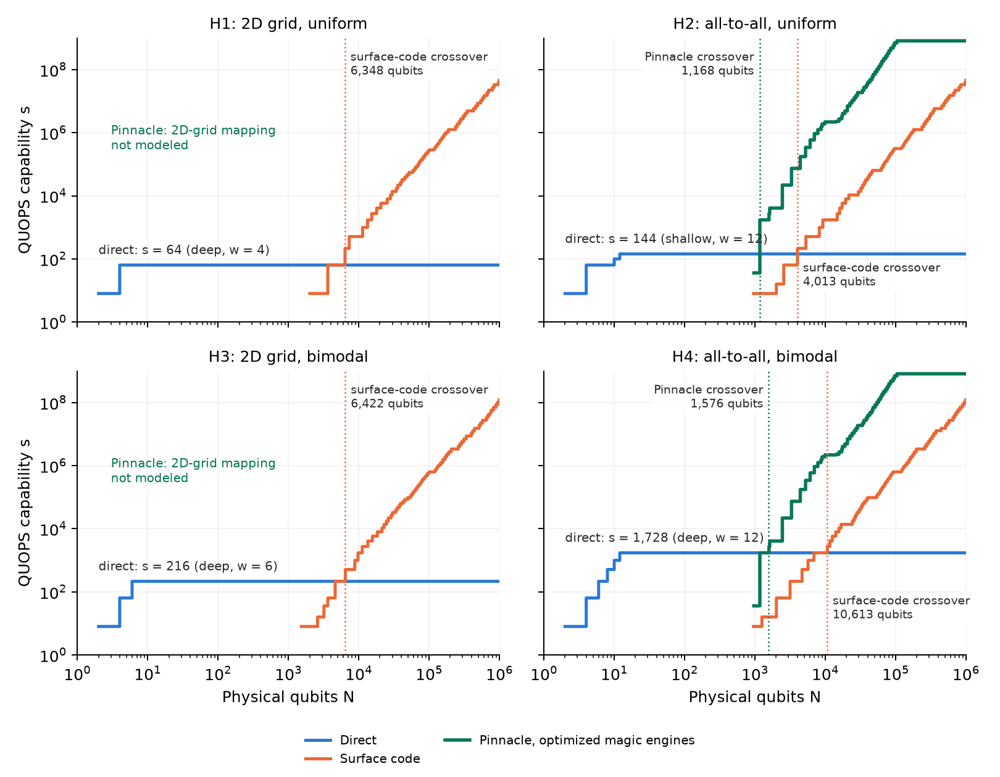

# QUOPS capability for the original Pinnacle architecture

> **Update (final menus, fold-transversal cultivation).** `capability/pinnacle.py` searches magic engines and factories
> (Sec. 3.7 of the draft) along three pathways: (A) physical T states injected in place into a GB-block engine, (B) cultivated
> inputs distilled in a GB-block engine with the template of the published 15-to-1 engine, and (C) cultivation and
> distillation on surface-code patches, delivered to the unit through an adapter. On all-to-all hardware, the only hardware
> modeled for Pinnacle, color-code cultivation (Gidney, Shutty, Jones) is replaced by fold-transversal cultivation (Sahay et
> al., arXiv:2509.05212): an f = 5 factory of 449 qubits, error 1e-9, 9.3e3 qubit-cycles per state ('fold_cultivation',
> family 'surface_fold' behind the adapter), and f = 3 states (error 2e-6, 337-qubit patches, 1.5e3 qubit-cycles per state)
> as inputs of every surface-code distillation layout ('fold f=3'). The volumes are read from Fig. 2b of that paper, one
> gate step counted as t_op, with the packing factor 1.55 of the color-code cultivation row. Every protocol of the factory
> catalogues is costed by `scripts/catalogue_factories.py` (results/catalogue_factories.json). The winners
> (`PINNACLE_WINNERS`, `FROZEN_WINNERS`, `FOLD_JWS_WINNERS`, `FOLD_CATALOGUE_WINNERS`) come from the every-width search of
> `scripts/find_winners.py` (results/winners.json): fold-transversal cultivation behind adapters, the published 15-to-1
> engines, the [[28,1,3]], [[32,1,3]], [[47,5,3]], [[56,8,3]] engines (B), and layouts of [[14,1,2]] and [[15,1,3]] fed by
> fold-transversal f = 3 states (C). Pathway A never sets a point at the best quoted in-place rejection (0.875 per
> attempt, arXiv:2606.28518). The surface-code comparison curves of H2 and H4 (Figs. 7 and 8) also use fold-transversal
> cultivation; H1 and H3 keep color-code cultivation. `scripts/fold_cultivation_comparison.py` reruns the all-to-all
> comparison with unfiltered menus (with CATALOGUE_JSON set to a `--yield-rule tcount` catalogue it is the T-count
> upper-bound check). The GB code distances are d = 6, 10, 16, 24. The schedule follows Sec. 3.5 with `F` magic engines or
> factories, a slot `D = max(d_t, t_r, s_F)`, and no final-measurement slots for QUOPS; surface-code factories and layouts
> run at the 600 ns surface-code cycle, the Pinnacle unit at 12 t_op = 1.2 us.
> With only the published engines it reproduces the serial estimate below (crossover 4,862; width-84 design with 9,570
> qubits) up to the plateau, where it allows several engines. `scripts/make_pinnacle_curves.py` keeps the provenance fields
> read by `make_frozen_pinnacle_curves.py`.
> The sections below document the original serial model, which `capability/frozen_pinnacle.py` still follows.
> The one-at-a-time sensitivities are now stored in `results/pinnacle.json` (`extended.sensitivity`), so the former
> `results/pinnacle_sensitivity.json` and `figures/pinnacle_sensitivity.*` were removed. `make_frozen_pinnacle_curves.py` keeps
> the shared 1 us cycle, whereas the paper's Frozen numbers (appendix) come from `make_pinnacle_curves.py` at 1.2 us.
> Cycle times follow 100 ns per time step: the Pinnacle unit runs at 12 t_op = 1.2 us, while surface-code factories and
> layouts behind the adapter run at the 6 t_op = 600 ns surface-code cycle (`Choices.surface_cycle_seconds`), and the
> surface-code comparison curve (`surface_sc` in `results/pinnacle.json`) is the cached model at 600 ns. QUOPS has no
> final measurements, so the schedule adds only the startup slot (`Choices.final_measurements=False`, N_M = 0, as in the
> surface-code QUOPS runtime); the Frozen CCZ runs use `frozen_pinnacle.vary(final_measurements=False)`.

This serial Pinnacle resource estimate uses the original architecture described in
[arXiv:2602.11457v2](https://arxiv.org/html/2602.11457v2), revised 5 May 2026.
The comparison plots use counted sequential PBC for the surface-code baseline.

The calculation is an auditable count of resources and modeled fault exposure,
not a quantum-state simulation or a compiled hardware schedule. In particular,
the one-week test below uses **expected runtime with internal magic-engine
retries**, not a guarantee of completion by the deadline.

## Files and reproduction

- `capability/pinnacle.py`: layout, schedule, error budget, and finite design search.
- `scripts/make_pinnacle_curves.py`: comparison and sensitivity calculations and plots.
- `tests/test_pinnacle.py`: independent arithmetic, published parameters, search, and boundary checks.
- `results/pinnacle.json`: full comparison rows and exact fixed-budget probes.
- `results/pinnacle_sensitivity.json`: one-at-a-time changes to the Pinnacle assumptions.
- `figures/quops_direct_surface_pinnacle.{png,pdf}`: the four hardware panels.
- `figures/pinnacle_sensitivity.{png,pdf}`: sensitivities on supported hardware.

From the repository root, using Python with the existing requirements installed:

```powershell
python scripts/make_pinnacle_curves.py
python -m pytest -q -p no:cacheprovider tests/test_pinnacle.py
```

Use `--skip-sensitivity` for only the main comparison. The plotting script reads
the committed `results/baseline.json` for direct and surface-code reference
curves. It verifies the shared configuration and hardware and records a SHA-256
of canonical parsed JSON.
The `canonical-json-sha256-v1` format sorts keys and ignores line endings and
formatting, so Windows and Linux checkouts use the same provenance. Comparisons
under changed shared parameters need separately matched reference data; the
sensitivity figure therefore contains Pinnacle curves only.

## 1. Workload and supported hardware

Reuse `quops.layer_counts` and `quops.size` without modification. For width `w`
and rotation-layer count `L_R`, there are `R = w L_R` arbitrary rotations. Each
rotation uses `t` synthesized T gates, giving `tau = R t` consumed magic states.
The same saved gridsynth fit as the surface-code model supplies

\[
\epsilon(t)=2^{-(t-b)/a},\qquad a=3.0764791908264293,\quad b=1.0970643939393736.
\]

The finite search uses every integer `t` from 5 to 160. This is a fitted mean
synthesis cost, not a per-angle compilation guarantee.

H2 and H4 support the required physical operations. Pinnacle does not require
global all-to-all connectivity: its interactions and gadget reconfiguration
are confined to the scale of a processing block. H1 and H3 are strict
nearest-neighbor grids, and their placement, routing, and resulting error costs
are **not modeled** here. The missing curves are not an impossibility claim or
zero-capability prediction. A native block-scale connectivity class is absent
from the repository's four hardware classes; H2/H4 grant more connectivity
than Pinnacle needs. The published engine menu is used only at `p = 10^-3`.

The source fit uses circuit-level depolarizing noise. Both H2 and H4 use it at
the same `p`; the model claims no gain from H4's lower one-qubit error rate.
This is an explicit uniform-noise proxy, not a separately simulated bimodal fit.

## 2. Layout and available designs

Each execution copy has one processing unit and one magic engine, with no
separate memory. The code menu is from Table 1 of the paper, restricted to the four distances that set a point on the curves (d = 6, 10, 16, 24):

| Code `[[n,k,d]]` | Native logical cycle `d_t` | Physical qubits per processing block |
|---|---:|---:|
| `[[30,8,4]]` | 6 | 140 |
| `[[62,10,6]]` | 8 | 244 |
| `[[126,12,10]]` | 12 | 452 |
| `[[254,14,16]]` | 18 | 860 |
| `[[510,16,24]]` | 26 | 1,620 |

These footprints already include check qubits, measurement gadgets, and bridges.
The unit has `beta = ceil(w/k)` processing blocks, including unused logical
capacity in its final block. Equations 9-10 and Section V.2.2 supply two engines:

| Engine output-error target | Physical qubits | Reject probability | Engine code distance |
|---|---:|---:|---:|
| `10^-9` | 4,410 | 0.10 | 24 |
| `10^-11` | 5,430 | 0.10 | 24 |

Thus the footprint per independent copy is

\[
N_{\rm copy}=\beta n_{pb}+n_{me}.
\]

Engine errors are treated as the paper's output-state targets, used once per
consumed state. The engine footprint includes its injection ancillas. No second
factory footprint or duplicate output-error charge is added. As in the paper,
negligible residual engine-code errors are neglected in that black-box target.

## 3. Schedule and rejection

Use serial Pauli-based computation (Section IV.2.1). Clifford gates, including
QUOPS CNOTs, update the classical frame. They do not each require an additional
logical surgery. Each T gate requires one serial Pauli measurement, followed by
`w` serial final measurements. No free within-unit T-layer parallelism is assumed.

Equation 11 gives protocol durations of 23 and 26 code cycles for the two
engines at reaction time `10 t_c`. Both engine code blocks have native logical
period 26. The shared slot duration is therefore

\[
D=\max\{d_t,26,\text{engine protocol cycles},t_r/t_c\}.
\]

It equals 26 in the baseline, including for data codes whose native period is
shorter. One extra startup slot primes the empty engine and prepares the data
concurrently (declared choice). With reject probability `r`, the total number
of engine production attempts `A` is the sum of `tau` independent geometric
variables, each supported on `1,2,...`. The pipelined schedule takes

\[
L=A+w+1,\qquad \mathbb E[L]=\frac{\tau}{1-r}+w+1,
\qquad \mathbb E[T]=D\,t_c\,\mathbb E[L].
\]

The extra slot includes consumption of the last produced state; earlier
consumption overlaps production. Rejects cause idle stalls, not full-circuit
restarts. Decoder and control throughput beyond the declared reaction time are
assumed feasible. Multiple interacting units and Clifford-frame cleaning are
outside this serial baseline.

## 4. Errors and pass criterion

Use the logical-measurement central fit from Equation 12 and Table 2:

\[
p_{\rm block}=6.2\left(\frac{p}{0.0158}\right)^{d/2+0.47}.
\]

This is per *whole block* over its native `d_t` code cycles. It is not a
per-code-cycle probability or a per-qubit probability. A stretched slot has
data hazard

\[
h=\eta\,\beta\,\frac{D}{d_t}\,[-\ln(1-p_{\rm block})].
\]

Charging the whole final block includes padded logical capacity. The scaling
with duration and independent block/time hazards are declared approximations.
The source simulation decoded X-type detectors; the baseline uses `eta = 2`
as a symmetry approximation for both X and Z sectors, with `eta = 1` included
as a sensitivity case. The larger-distance rates are extrapolations of the
paper's fit, not direct measurements at all distances. The fit also assumes
ideal most-likely decoding; a sufficiently fast real-time decoder has not
been demonstrated by these estimates.

With per-slot survival `s = exp(-h)`, a geometric wait has mean survival
`(1-r)s/(1-rs)`. Consequently the data's *mean* survival is evaluated without
substituting the mean runtime into its exponential:

\[
Q_{\rm data}=e^{-(w+1)h}
\left[\frac{(1-r)e^{-h}}{1-re^{-h}}\right]^\tau.
\]

This assumes independent stationary retries and fault hazards. It is evaluated
using `expm1` and `log1p` for stability at very small logical-error rates.
The stochastic no-fault estimate and synthesis charge are kept distinct:

\[
q_{\rm no\ fault}=Q_{\rm data}(1-p_{\rm out})^\tau,
\qquad \ell_{\rm synth}=R\epsilon^2,
\qquad \text{quality}=q_{\rm no\ fault}\,e^{-\ell_{\rm synth}}.
\]

By default, `-log(quality) <= 0.5`, matching the repository's surface-code
effective-quality budget. Synthesis is an approximation error, not a
stochastic fault. The shared linear charge, synthesis scale, and separate
synthesis budget are also supported with the same meanings as in `surface.py`.

## 5. Copies, search, and exact probes

For `M` requested executions and a week `W`, use

\[
B=\min\{\lfloor W/\mathbb E[T]\rfloor,M\},\qquad
K=\lceil M/B\rceil,\qquad N=K N_{\rm copy}.
\]

A design is infeasible when `B < 1` or its quality budget fails. Each copy
contains its own data blocks and engine. Copies do not divide a single
execution across units. This is an expected-time throughput estimate; internal
reject variance can prevent completion by a deadline even when this test passes.

`min_qubits` minimizes `N` over the code, engine, and T-count menus. Area ties
prefer shorter mean runtime, then lower loss. It returns the same basic row
fields consumed by `curves.py`, plus the chosen architecture and loss details.
`sweep`, `best_at`, and `capability` mirror the surface-code interface. New
architecture choices live in the new module's frozen `Choices` dataclass.

For each fixed candidate, block count, T demand, hazard, synthesis charge,
runtime, required copies, and footprint are nondecreasing with width. A
candidate that passes at `w+2` therefore passes at `w` with no more qubits.
This proves the monotonicity needed for early termination and bisection.
Plotting samples every even width through 100 and then about 6.5% apart,
matching the existing plot resolution. Probes at `10^4` and `10^6` qubits are
refined over every even width and inserted into the plotted rows. Exactness
means within this finite serial model, not among all Pinnacle implementations.

## 6. Baseline results

The horizontal axis is the total physical-qubit budget, including code blocks
and magic engines. The vertical axis is the largest passing QUOPS circuit size
`s = w * layers`, not executions per second. The baseline requests one execution
within the one-week mean-time budget. Higher at a fixed qubit budget means a
larger circuit; farther left at a fixed circuit size means fewer physical
qubits. Both axes are logarithmic.



| Hardware | First qubits where Pinnacle exceeds direct | Pinnacle `s` at `10^4` qubits | Pinnacle `s` at `10^6` qubits |
|---|---:|---:|---:|
| H1, grid/uniform | not modeled | not modeled | not modeled |
| H2, all-to-all/uniform | 4,862 | 592,704 | 851,971,392 |
| H3, grid/bimodal | not modeled | not modeled | not modeled |
| H4, all-to-all/bimodal proxy | 5,270 | 592,704 | 851,971,392 |

The `10^4`-qubit probe is a width-84 deep circuit with distance-16 data blocks,
one `10^-9` engine, 9,570 physical qubits, and expected runtime about 274 seconds.
The `10^6`-qubit probe is width 948 deep with distance-24 data blocks and one
`10^-11` engine. It uses only 102,630 physical qubits and has expected runtime
about 603,006 seconds (6.98 days). The final plateau is therefore primarily a
serial time limit, not an inability to allocate more data blocks.

The sensitivity outputs vary the Pauli-sector factor, code-cycle duration,
execution count, engine menu, and synthesis charge one at a time. These are
model tests and arithmetic checks; they do not validate a real decoder,
nonlocal hardware, or the full architecture experimentally.
