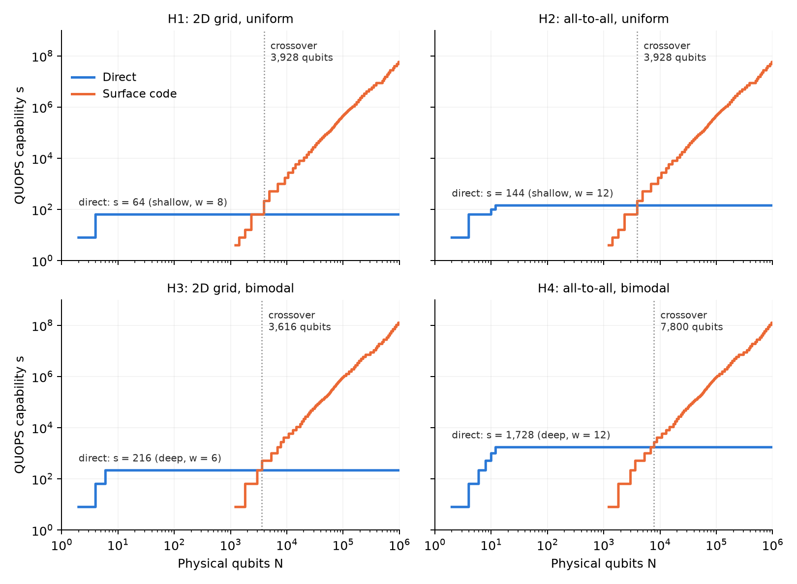

# QUOPS capability for direct and surface-code implementations

*Methods note for group discussion. This is a first pass, with the simplest reasonable choice at each
step. Draft section numbers refer to the Overleaf snapshot of 13 October 2026.*

Where the capability plateau ends depends on modeling choices that the draft does not yet fix. We fix
each one in the simplest reasonable way, compute both curves, and then change the choices one at a time
to see which ones the answer depends on. This note describes that calculation for QUOPS on the four
hardware classes H1 to H4, using the direct implementation (Sec. 3.2) and the surface-code
implementation (Sec. 3.5). All choices are set in `capability/config.py`, and `scripts/what_matters.py`
reproduces the comparison in Sec. 6.

## 1. What is computed, and how

Neither curve simulates a quantum state. Each is a count of fault locations in a scheduled circuit,
turned into a mean no-fault probability with the draft's product formula (Sec. 3.1) and then minimized
over a small set of implementation choices. The one state-vector simulation, in Sec. 4, checks how
synthesis errors accumulate. The table lists where each ingredient comes from.

| Ingredient | How it is obtained |
|---|---|
| Hardware classes, QUOPS ensembles, pass criterion, $P_{\rm SC}(d,p)$, $2d^2$ qubits per patch | taken from the draft (Secs. 2.1, 2.2, 3.5) |
| Direct, all-to-all: mean no-fault probability | closed-form formula (Sec. 3) |
| Direct, 2D grid: SWAP counts and idle steps per CNOT layer | compiled and counted. Each sampled circuit is routed by an explicit SWAP network, and the mean is taken over 64 circuits. |
| T gates per synthesized rotation | compiled and counted. Gridsynth on 64 random angles per tolerance is fitted to $n_T = 3.08\log_2(1/\epsilon) + 1.10$ (`results/synthesis_fit.json`), where $\epsilon$ is pygridsynth's diamond-norm tolerance. In the operator-norm convention of Ross and Selinger ($\epsilon_{\rm op} \approx \epsilon/2$) the same fit reads $3.08\log_2(1/\epsilon_{\rm op}) - 1.98$. |
| How synthesis errors accumulate in a circuit | simulated. State vectors at $w \le 8$, with every rotation replaced by its gridsynth word (`results/synthesis_accumulation.json`). |
| Factory output errors; Litinski footprints and periods | from the literature. Cultivation (Gidney, Shutty, and Jones, 2024, arXiv:2409.17595, $2\times10^{-9}$ per state) and the seven $p=10^{-3}$ factories of Litinski (2019, arXiv:1905.06903, Table 1), each at the source's own circuit-noise estimate. |
| Cultivation footprint and period | our supply assumptions, 1,024 qubits and 100 cycles per delivered state, about 1.5 times the source's expected volume per state. No cultivation factory has been laid out. |
| Surface-code layout and schedule | declared, not compiled. No layout, CNOT routing, or T-state delivery has been demonstrated (Sec. 4). |
| Direct schedule and compilation rules | declared choices (`config.py`), each varied in Sec. 6 |

## 2. Inputs taken from the draft

The four hardware classes cross 2D nearest-neighbor or all-to-all CNOT connectivity with uniform noise
($\varepsilon_{\rm 1Q} = \varepsilon_{\rm 2Q} = p$) or bimodal noise ($\varepsilon_{\rm 1Q} = p/1000$,
$\varepsilon_{\rm 2Q} = p$), with $p = 10^{-3}$. Here $\varepsilon_{\rm 1Q}$ covers $H$, $Z(\theta)$, and
idle locations, and $\varepsilon_{\rm 2Q}$ covers CNOTs, preparations, and measurements. A QUOPS circuit
on an even number $w$ of qubits alternates rotation layers (an independent $R_P(\theta)$ on every qubit,
$P$ uniform in $\{X, Y, Z\}$) and CNOT layers (an independent uniformly random pairing). The shallow
ensemble has $w$ layers and size $s = w^2$, and the deep ensemble has $w^2$ layers and size $s = w^3$. A
width passes in an ensemble if the mean no-fault probability is at least $e^{-1/2}$, and the
capability $C(N)$ is the largest passing size whose implementation needs at most $N$ physical qubits.

## 3. Direct implementation

We take the simplest schedule, in which every native operation takes one time step. Preparation and
measurement take one step each, a CNOT layer takes one step on all-to-all hardware, and a rotation
layer lasts as long as its slowest qubit. With the draft's gate set $\{H, Z(\theta)\}$, the rotations
compile as $R_Z = Z(\theta)$, $R_X = H Z(\theta) H$, and $R_Y = S H Z(\theta) H S^\dagger$, which take 1,
3, and 5 steps. A rotation layer therefore lasts 5 steps unless no qubit drew $Y$. Every CNOT,
preparation, and measurement is a location at $\varepsilon_{\rm 2Q}$, and every one-qubit gate, and
every step in which a qubit is untouched, is a location at $\varepsilon_{\rm 1Q}$.

On all-to-all hardware the layers are independent, so the mean no-fault probability factorizes,
$$
\bar q = (1-\varepsilon_{\rm 2Q})^{2w}\,(1-\varepsilon_{\rm 2Q})^{L_C w/2}
\Big[\sum_{D\in\{1,3,5\}} \Pr(D)\,(1-\varepsilon_{\rm 1Q})^{wD}\Big]^{L_R}, \tag{1}
$$
where $L_C$ and $L_R$ are the numbers of CNOT and rotation layers, $D$ is the duration of a rotation
layer, and $\Pr(D=5) = 1-(2/3)^w$, $\Pr(D=3) = (2/3)^w - (1/3)^w$, and $\Pr(D=1) = (1/3)^w$. Under uniform
noise every qubit pays about $5p$ per rotation layer but only $p/2$ per CNOT layer, so the rotation
layers dominate by an order of magnitude.

On the 2D grid the qubits sit on the smallest rectangle with an even number of columns, and each CNOT
layer is preceded by rounds of disjoint nearest-neighbor SWAPs (three CNOT steps each) that bring every
pair together. The baseline router places pairs on consecutive sites of a boustrophedon path and sorts
along it by odd-even transposition. The alternative router uses minimum-distance domino targets and
row-column-row sorting. Because the routing depends on the placement left by earlier layers, we average
the no-fault probability over 64 sampled circuits. The standard error of that mean is below $0.005$.

The resulting capabilities are $s = 64$ on H1, 144 on H2, 216 on H3, and 1,728 on H4. On all-to-all
hardware the two ensembles cost almost the same per unit of size. A rotation layer and a CNOT layer add
$2w$ to the size and cost about $(5w + w/2)p$ under uniform noise and $wp/2$ under bimodal noise, so
$-\ln\bar q \approx 2.75\,ps$ and $0.25\,ps$, plus $2wp$ for preparation and measurement. Before that
last term the criterion allows $s \approx 180$ and $s \approx 2{,}000$, and the capability is the largest
size of either ensemble that passes, $144 = 12^2$ on H2 and $1{,}728 = 12^3$ on H4. Which ensemble sets
the capability on all-to-all hardware is therefore decided by which allowed size, $w^2$ or $w^3$, falls
just below the limit. On the grid the SWAP cost of a CNOT layer grows with $w$, so the deep ensemble,
which reaches a given size with fewer qubits, costs less per unit of size. It sets the capability on H3
($w = 6$), and on H1 the two ensembles tie at $s = 64$ ($w = 8$ shallow, $w = 4$ deep).

## 4. Surface-code implementation

The logical layout gives each of the $w$ data patches one routing patch beside it, so the computation
occupies $2w$ tiles of $2d^2$ physical qubits each, all live throughout. A CNOT layer takes two
lattice-surgery steps of $d$ cycles, with all $w/2$ long-range CNOTs running at once. Each rotation is
synthesized to $n_T(\epsilon)$ T gates, and each T gate consumes one factory state in one surgery step,
measured in the rotation's own Pauli basis so that no logical Hadamard is needed. Rotations on
different qubits run in parallel, so with $F$ factories of period $\tau_F$ a rotation layer takes
$\max(n_T d,\ \lceil w n_T/F\rceil\,\tau_F)$ cycles. The loss is given by
$$
-\ln \bar q = V\,\lambda(d) + N_T\,\lambda_F + R\,\epsilon^2, \qquad \lambda(x) = -\ln(1-x), \tag{2}
$$
where $V$ is the number of live patch-cycles, $\lambda(d) = \lambda(P_{\rm SC}(d,p))$ with the draft's
$P_{\rm SC} = 0.03\,(p/p_{\rm th})^{(d+1)/2}$, $N_T = R\,n_T$ is the number of consumed T states,
$\lambda_F$ is the factory's output error, and $R = wL_R$ is the number of rotations. The last term
charges each rotation $\epsilon^2$. Here $\epsilon$ is the tolerance passed to gridsynth, a bound on the
diamond-norm distance between the synthesized and the exact rotation, which is to leading order twice
the operator-norm distance minimized over global phase.

The last term needs an interpretation, because the draft budgets synthesis error "separately from
stochastic failure" while the QUOPS criterion counts only faults. We read the criterion as a bound on
the no-fault probability times the fidelity of the fault-free output with the ideal output. Synthesis
error, which is not a fault, then enters through that fidelity, and each rotation costs its infidelity
as long as the errors of different rotations add incoherently. A direct simulation indicates that they
do (`scripts/check_synthesis_accumulation.py`). We sampled QUOPS circuits at $w \le 8$ (32 to 256
rotations) and replaced every rotation by its gridsynth word at $\epsilon$ from 0.01 to 0.05. The mean
output infidelity is then 0.76 to 0.95 times $\sum_i\delta_i^2$, where $\delta_i \le \epsilon/2$ is the
phase-free operator-norm error of rotation $i$, while the coherent estimate $(\sum_i\delta_i)^2$ is 35 to
260 times larger. Since the mean of $\delta_i^2$ is $0.14$ to $0.15\,\epsilon^2$ for single rotations
from $\epsilon = 10^{-2}$ down to $10^{-8}$, the charge $R\epsilon^2$ overstates the measured infidelity
by a factor of 7 to 9. We keep it as a conservative baseline. Sec. 6 shows three alternatives, the
measured charge ($0.14\,R\epsilon^2$), a linear charge (the coherent worst case), and a separate budget.
None of them moves the crossover by more than 28% or the capability at $10^6$ qubits by more than 13%.

For each width we search over every distance, factory type, T count per rotation (each with the
loosest tolerance that gives it), and factory count, for the fewest physical qubits
$N = K\,(2w\cdot 2d^2 + F N_F)$. A design passes if $-\ln\bar q \le 1/2$ and if its $K$ copies complete
the $M$ requested executions within the week $W$. Each copy runs executions of duration $T$ back to
back, so the second condition is $K\lfloor W/T\rfloor \ge M$. The baseline cycle is 1 µs. Within the
model the search is exact, and a test compares it with a brute-force search over factory counts.
Because the fewest qubits never decrease with $w$ (a design that passes at $w+2$ also passes at $w$),
the capability at a given $N$ is exact over every even width, not only the sampled ones.

The layout and the schedule are assumptions. We have not routed the simultaneous long-range CNOTs,
factory outputs reach the consuming patches at no cost, and the tests check the arithmetic of the
schedule, not whether it can be realized. The CNOT side can be bounded, because one CNOT at a time can
be realized in any connected routing region. With that serial schedule the crossover does not move,
and the capability at $10^6$ qubits falls by 1.5% (Sec. 6). T-state delivery has no such bound.
Doubling its surgery time changes nothing at the probes of Sec. 6, but only a compiled layout would
settle the question.

At the crossover with direct computation, the surface-code design has 6 to 14 logical qubits at
distance 9 to 11 and a single cultivation factory. It accepts rotations with $\epsilon$ between 0.014
and 0.055, so synthesis error carries 40 to 64% of the loss budget. The design at $10^6$ qubits is
different. It has 390 to 514 logical qubits at distance 21 to 23, fed by three distillation factories,
and runs the deep ensemble once in 5 to 23 hours. Patch failures take 62 to 86% of its loss and the run
uses at most 14% of the week, so this design is limited by area, not by time.

## 5. Baseline curves



| | H1 grid, uniform | H2 all-to-all, uniform | H3 grid, bimodal | H4 all-to-all, bimodal |
|---|---|---|---|---|
| Direct capability $s$ | 64 | 144 | 216 | 1,728 |
| Crossover $N$ | 3,928 | 3,928 | 3,616 | 7,800 |
| Surface code, $s$ at $N=10^6$ | $5.9\times10^7$ | $5.9\times10^7$ | $1.4\times10^8$ | $1.4\times10^8$ |

The curves, and every number in this note, stop at $N = 10^6$ physical qubits (`N_MAX` in
`capability/config.py`). Every number quoted in this note is exact within the model. The crossover is
found at the steps of the two curves rather than on a plotting grid, and capabilities at fixed $N$ are
refined over every even width. Only the plotted staircase samples widths about 6.5% apart above
$w = 100$.

The short flat step of each surface-code curve near $s \approx 10^7$ is where the designs change from
cultivation to distillation factories, at $3.9\times10^5$ qubits under uniform noise and $3.0\times10^5$
under bimodal noise. Factory errors take up to 0.38 of the 0.5 budget just before the change, close to
the cultivation ceiling of Eq. (3) in Sec. 6. The first distillation factory used, Litinski's
$2.7\times10^{-12}$ factory, is 30 times larger and has a 740 times lower output error, and above the
change factory errors take at most 0.15 of the budget.

The surface-code curves of H1 and H2 (and of H3 and H4) coincide, because the baseline surface-code
model does not use all-to-all connectivity. The draft's Fig. 3 assigns the surface code to the 2D
classes only, while Sec. 4 lists four surface-code cases. The all-to-all curves here are a placeholder
until that is settled.

## 6. What matters

The table changes one choice at a time from the baseline (`docs/what_matters_table.md`,
`results/what_matters.json`).

| Choice | Direct $s$ (H1 / H2 / H3 / H4) | Crossover $N$ (H1 / H2 / H3 / H4) | Surface $s$ at $10^4$ (uniform / bimodal) | Surface $s$ at $10^6$ (uniform / bimodal) |
|---|---|---|---|---|
| baseline | 64 / 144 / 216 / 1,728 | 3,928 / 3,928 / 3,616 / 7,800 | 1,728 / 4,096 | 5.9e7 / 1.4e8 |
| direct: no idle errors | 100 / 256 / 216 / 1,728 | 3,928 / 4,896 / 3,616 / 7,800 | 1,728 / 4,096 | 5.9e7 / 1.4e8 |
| direct: native $R_P$ | 64 / 576 / 216 / 1,728 | 3,928 / 6,888 / 3,616 / 7,800 | 1,728 / 4,096 | 5.9e7 / 1.4e8 |
| direct: row-column-row router | 64 / 144 / 216 / 1,728 | 3,928 / 3,928 / 3,616 / 7,800 | 1,728 / 4,096 | 5.9e7 / 1.4e8 |
| surface: serial CNOTs | 64 / 144 / 216 / 1,728 | 3,928 / 3,928 / 3,616 / 7,800 | 1,728 / 4,096 | 5.8e7 / 1.4e8 |
| surface: 2 steps per T | 64 / 144 / 216 / 1,728 | 3,928 / 3,928 / 3,616 / 7,800 | 1,728 / 4,096 | 5.9e7 / 1.4e8 |
| surface: compact layout (1.5 tiles) | 64 / 144 / 216 / 1,728 | 3,202 / 3,202 / 2,968 / 6,106 | 4,096 / 8,000 | 1.3e8 / 2.7e8 |
| surface: roomy layout (3 tiles) | 64 / 144 / 216 / 1,728 | 5,380 / 5,380 / 5,936 / 11,188 | 512 / 1,728 | 2.3e7 / 4.9e7 |
| surface: synthesis charged linearly | 64 / 144 / 216 / 1,728 | 3,928 / 3,928 / 4,640 / 8,824 | 1,728 / 4,096 | 5.5e7 / 1.2e8 |
| surface: synthesis at measured infidelity ($0.14\,\epsilon^2$) | 64 / 144 / 216 / 1,728 | 3,928 / 3,928 / 3,616 / 7,800 | 1,728 / 4,096 | 6.4e7 / 1.4e8 |
| surface: synthesis budgeted separately ($\sum\epsilon^2 \le 1/2$) | 64 / 144 / 216 / 1,728 | 3,928 / 3,928 / 3,616 / 7,800 | 1,728 / 4,096 | 6.7e7 / 1.5e8 |
| surface: cultivation only | 64 / 144 / 216 / 1,728 | 3,928 / 3,928 / 3,616 / 7,800 | 1,728 / 4,096 | 1.1e7 / 1.1e7 |
| surface: distillation only | 64 / 144 / 216 / 1,728 | 6,564 / 6,564 / 7,212 / 11,396 | 1,000 / 1,000 | 5.9e7 / 1.4e8 |
| surface: $P_{\rm SC}$ prefactor 0.1 | 64 / 144 / 216 / 1,728 | 3,928 / 3,928 / 4,896 / 8,824 | 1,000 / 2,744 | 5.5e7 / 1.1e8 |
| surface: no bimodal threshold gain | 64 / 144 / 216 / 1,728 | 3,928 / 3,928 / 4,896 / 10,488 | 1,728 / 1,728 | 5.9e7 / 5.9e7 |
| surface: 1 ms cycle | 64 / 144 / 216 / 1,728 | 3,928 / 3,928 / 3,616 / 7,800 | 1,728 / 4,096 | 1.2e7 / 1.5e7 |
| both: $10^4$ executions in the week | 64 / 144 / 216 / 1,728 | 3,928 / 3,928 / 3,616 / 7,800 | 1,728 / 4,096 | 1.1e7 / 1.1e7 |

We draw three readings from the table. First, every single change keeps the crossover between 2,968
and 11,396 physical qubits. For QUOPS, within this model, this answers the first of the project's
central questions. The crossover lies between $10^3$ and $10^4$ qubits, and it passes slightly above
$10^4$ only for bimodal all-to-all hardware under three pessimistic changes (roomy layout, distillation
only, no bimodal threshold gain). The reason is that direct capability is small ($s \le 1{,}728$), so
the surface code needs only a handful of logical qubits to exceed it. The crossover therefore sits where
one cultivation factory and 12 to 28 tiles at distance 9 to 11 fit on the chip. Thus the crossover is
sensitive to factory and layout area and nearly insensitive to how direct computation is modeled. The
direct-side choices move it only on H2 (to 4,896 without idle errors and 6,888 with native $R_P$).

Second, the choices that decide the direct capability matter only under uniform noise. Idle errors and
the five-step $R_Y$ cost up to a factor of 4 in $s$ on H1 and H2 and nothing on H3 and H4. The router
does not matter at these widths (the snake is cheaper below about 16 qubits, row-column-row above).

Third, the large-$N$ end of the surface-code curve is set by three different mechanisms, which can be
read from the winning design of each row (stored with its loss split and run time in
`results/what_matters.json`). In the baseline, area and loss set the limit (Sec. 4). With cultivation
alone, the quality of the output states sets it. The capability stops at $s = 1.06\times10^7$ on every
hardware class, the winning design uses only $3.7$ to $5.0\times10^5$ of the $10^6$ qubits and runs for
7 to 13 minutes, and magic-state errors take 0.469 of the 0.5 budget. A deep-ensemble circuit has about
$s/2$ rotations of $n_T \approx 44$ T states each, so a factory with output error $\varepsilon_T$ limits
the capability to
$$
s \lesssim \frac{1}{n_T\,\varepsilon_T} \approx 1.1\times10^{7} \quad \text{(cultivation)}, \tag{3}
$$
where the approximation neglects the synthesis and patch shares of the budget. That is, the factory's
output error caps the capability however many qubits are available. With a 1 ms cycle, time sets the
limit instead, and the single run takes 98% of the week. Requiring $10^4$ executions combines
the two limits. Each run must then finish in about 60 s, and within $10^6$ qubits only many small
factories can supply T states that fast. The winning design feeds one copy from 395 cultivation
factories and runs the $10^4$ executions back to back in 98% of the week, so it reaches the cultivation
ceiling of Eq. (3). No design at $10^6$ qubits uses a second copy.

The layout area matters at both ends of the curve. It moves the crossover by up to 64% and the
capability at $10^6$ qubits by a factor of 2.0 to 2.8.

## 7. Proposed clarifications to the draft definitions

These are the places where we had to choose, written as proposals for Secs. 2.1, 2.2, 3.2, and 3.5.

1. Time steps and idles (Sec. 2.1). State that every native operation takes one time step and that
   each qubit untouched in a step is one idle location, or give operation durations. Under uniform
   noise this convention alone changes the direct capability by up to a factor of 1.8.
2. Rotation compilation (Secs. 2.2 and 3.2). State whether $R_P(\theta)$ is compiled into $H$ and
   $Z(\theta)$ (1, 3, or 5 steps) or treated as one native operation. This is the largest single
   effect on direct capability under uniform noise (a factor of 4 on H2).
3. Layer order (Sec. 2.2). State whether a circuit starts with a rotation or a CNOT layer. We start
   with rotations, so $L$ layers give $\lceil L/2\rceil$ rotation layers.
4. Repeated executions (Sec. 2.2). The QUOPS criterion has no shot count. If the group wants one, it
   matters only for the surface-code capability at large $N$, where $10^4$ runs lower the capability at
   $10^6$ qubits by a factor of 6 to 13 by forcing the cultivation ceiling of Eq. (3).
5. Synthesis error (Sec. 3.5). The draft budgets it "separately" but gives no rule, and QUOPS has no
   accuracy target other than the no-fault criterion. We propose counting the output infidelity that
   synthesis causes inside the same $e^{-1/2}$ criterion, charged conservatively as $\epsilon^2$ per
   rotation with $\epsilon$ the diamond-norm tolerance. The check of Sec. 4 indicates that these errors
   add incoherently in QUOPS circuits, so the linear (coherent) charge overestimates them. Across the
   three alternatives in Sec. 6, the crossover moves by at most 28% (linear charge, bimodal hardware
   only) and the capability at $10^6$ qubits by at most 13%. For Fermi-Hubbard, whose accuracy target
   is an observable error, a separate budget as the draft describes is natural. The two problem classes
   need not share a rule.
6. Surface code on all-to-all hardware (Secs. 3 and 4). Decide whether the surface code is evaluated on
   H2 and H4, and if so whether it may use transversal CNOTs.
7. Layout and factories (Sec. 3.5). The tiles per logical qubit and the factory menu set the crossover,
   so we propose stating both explicitly. We also propose keeping the source estimates (output errors,
   Litinski footprints and periods) apart from the supply assumptions (the cultivation footprint and
   period, and free delivery of states to the consuming patch). The cultivation output error needs the
   most care, since through Eq. (3) it caps any design that relies on cultivation.
8. Surface-code schedule (Sec. 3.5). Decide whether declared schedules, bounded on one side by the
   serial-CNOT schedule, are enough for the paper, or whether one compiled layout is needed. Only a
   compiled layout would also bound T-state delivery.
9. Cycle time (Sec. 3.5). It is needed only for the one-week limit, and it matters at $10^6$ qubits and
   above.

## 8. Next complications, in the order the table suggests

The factory footprint and the layout set the crossover, so a more careful small-machine layout (for
example Litinski's compact block, with its slower T consumption) is the first refinement. Compiling it
would also test the declared schedule. The shot count, the cycle time, and the factory output errors
set the large-$N$ curve, so they should be settled as definitions before more effort goes into
factories or scheduling. On the direct side, unencoded error mitigation (the draft's open note in
Sec. 3.2) could raise $s$ by more than any compilation choice, and it is the one direct-side change
likely to move the crossover. Merging single-qubit Cliffords across layers and fusing SWAPs into CNOTs
would matter only under uniform noise.

## Reproducing

```
python -m venv .venv && .venv/bin/pip install -r requirements.txt
.venv/bin/python scripts/fit_synthesis.py      # ~1 min; writes results/synthesis_fit.json
.venv/bin/python scripts/make_curves.py        # ~10 s; results/baseline.json, figures/
.venv/bin/python scripts/what_matters.py       # ~3 min; results/what_matters.json, docs/what_matters_table.md
.venv/bin/python scripts/check_synthesis_accumulation.py   # ~8 min; results/synthesis_accumulation.json
.venv/bin/python -m pytest -q
```
