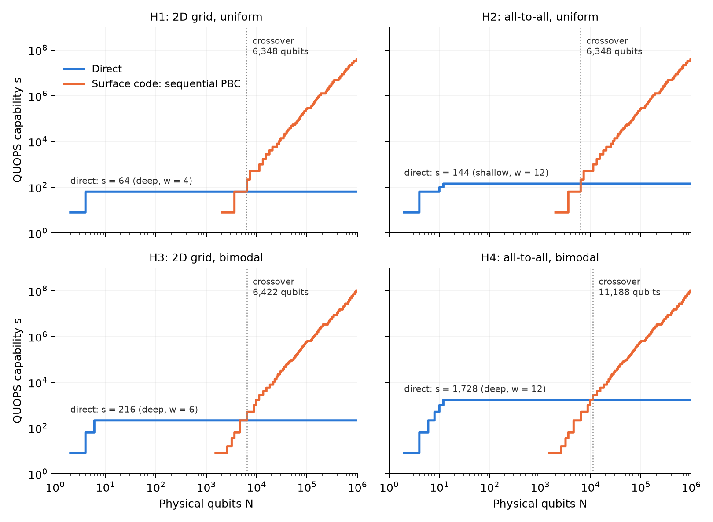

# QUOPS capability for direct and surface-code implementations

*Code methods note. Updated 10 November 2026 to use counted sequential PBC. Manuscript editing is managed separately in Overleaf.*

Where the capability plateau ends depends on modeling choices that the draft does not yet fix. We fix
each one in the simplest reasonable way, compute both curves, and then change the choices one at a time
to see which ones the answer depends on. This note describes that calculation for QUOPS on the four
hardware classes H1 to H4, using the direct implementation (Sec. 3.2) and the surface-code
implementation (Sec. 3.5). All choices are set in `capability/config.py`, and `scripts/what_matters.py`
reproduces the current PBC sensitivity comparison.

## 1. What is computed, and how

Neither curve simulates a quantum state. Each is a count of fault locations in a scheduled circuit,
turned into a mean no-fault probability with the draft's product formula (Sec. 3.1) and then minimized
over a small set of implementation choices. The one state-vector simulation, in Sec. 4, checks how
synthesis errors accumulate. The table lists where each ingredient comes from.

| Ingredient | How it is obtained |
|---|---|
| Hardware classes, QUOPS ensembles, pass criterion, $P_{\rm SC}(d,p)$, $2d^2$ qubits per patch | taken from the draft (Secs. 2.1, 2.2, 3.5) |
| Direct, all-to-all: mean no-fault probability | closed-form formula (Sec. 3) |
| Direct, 2D grid: SWAP counts and idle steps per CNOT layer | compiled and counted. Each sampled circuit is routed by an explicit SWAP network, and the mean is taken over 64 circuits. |
| T gates per synthesized rotation | compiled and counted. Gridsynth on 64 random angles per tolerance is fitted to $n_T = 3.08\log_2(1/\epsilon) + 1.10$ (`results/synthesis_fit.json`), where $\epsilon$ is pygridsynth's diamond-norm tolerance. In the operator-norm convention of Ross and Selinger ($\epsilon_{\rm op} \approx \epsilon/2$) the same fit reads $3.08\log_2(1/\epsilon_{\rm op}) - 1.98$. |
| How synthesis errors accumulate in a circuit | simulated. State vectors at $w \le 8$, with every rotation replaced by its gridsynth word (`results/synthesis_accumulation.json`). |
| Factory output errors; Litinski footprints and periods | from the literature. Cultivation (Gidney, Shutty, and Jones, 2024, arXiv:2409.17595, $2\times10^{-9}$ per state) and the seven $p=10^{-3}$ factories of Litinski (2019, arXiv:1905.06903, Table 1), each at the source's own circuit-noise estimate. |
| Cultivation footprint and period | our supply assumptions, 1,024 qubits and 100 cycles per delivered state, about 1.5 times the source's expected volume per state. No cultivation factory has been laid out. |
| Surface-code layout and schedule | counted fast-block geometry and sequential PBC with finite factory buffers; delivery and logical-error calibration remain assumptions (Sec. 4). |
| Direct schedule and compilation rules | declared choices (`config.py`), each varied in Sec. 6 |

## 2. Inputs taken from the draft

The four hardware classes cross 2D nearest-neighbor or all-to-all CNOT connectivity with uniform noise
($\varepsilon_{\rm 1Q} = \varepsilon_{\rm 2Q} = p$) or bimodal noise ($\varepsilon_{\rm 1Q} = p/1000$,
$\varepsilon_{\rm 2Q} = p$), with $p = 10^{-3}$. Here $\varepsilon_{\rm 1Q}$ covers $H$, $Z(\theta)$, and
idle locations, and $\varepsilon_{\rm 2Q}$ covers CNOTs, preparations, and measurements. A QUOPS circuit
on an even number $w$ of qubits alternates rotation layers (an independent $R_P(\theta)$ on every qubit,
$P$ uniform in $\{X, Y, Z\}$) and CNOT layers (an independent uniformly random pairing). The shallow
ensemble has $w$ layers and size $s = w^2$, and the deep ensemble has $w^2$ layers and size $s = w^3$. A
width passes in an ensemble if the mean no-fault probability is at least $e^{-1/2}$, and the
capability $C(N)$ is the largest passing size whose implementation needs at most $N$ physical qubits.

## 3. Direct implementation

We take the simplest schedule, in which every native operation takes one time step. Preparation and
measurement take one step each, a CNOT layer takes one step on all-to-all hardware, and a rotation
layer lasts as long as its slowest qubit. With the draft's gate set $\{H, Z(\theta)\}$, the rotations
compile as $R_Z = Z(\theta)$, $R_X = H Z(\theta) H$, and $R_Y = S H Z(\theta) H S^\dagger$, which take 1,
3, and 5 steps. A rotation layer therefore lasts 5 steps unless no qubit drew $Y$. Every CNOT,
preparation, and measurement is a location at $\varepsilon_{\rm 2Q}$, and every one-qubit gate, and
every step in which a qubit is untouched, is a location at $\varepsilon_{\rm 1Q}$.

On all-to-all hardware the layers are independent, so the mean no-fault probability factorizes,
$$
\bar q = (1-\varepsilon_{\rm 2Q})^{2w}\,(1-\varepsilon_{\rm 2Q})^{L_C w/2}
\Big[\sum_{D\in\{1,3,5\}} \Pr(D)\,(1-\varepsilon_{\rm 1Q})^{wD}\Big]^{L_R}, \tag{1}
$$
where $L_C$ and $L_R$ are the numbers of CNOT and rotation layers, $D$ is the duration of a rotation
layer, and $\Pr(D=5) = 1-(2/3)^w$, $\Pr(D=3) = (2/3)^w - (1/3)^w$, and $\Pr(D=1) = (1/3)^w$. Under uniform
noise every qubit pays about $5p$ per rotation layer but only $p/2$ per CNOT layer, so the rotation
layers dominate by an order of magnitude.

On the 2D grid the qubits sit on the smallest rectangle with an even number of columns, and each CNOT
layer is preceded by rounds of disjoint nearest-neighbor SWAPs (three CNOT steps each) that bring every
pair together. The baseline router places pairs on consecutive sites of a boustrophedon path and sorts
along it by odd-even transposition. The alternative router uses minimum-distance domino targets and
row-column-row sorting. Because the routing depends on the placement left by earlier layers, we average
the no-fault probability over 64 sampled circuits. The standard error of that mean is below $0.005$.

The resulting capabilities are $s = 64$ on H1, 144 on H2, 216 on H3, and 1,728 on H4. On all-to-all
hardware the two ensembles cost almost the same per unit of size. A rotation layer and a CNOT layer add
$2w$ to the size and cost about $(5w + w/2)p$ under uniform noise and $wp/2$ under bimodal noise, so
$-\ln\bar q \approx 2.75\,ps$ and $0.25\,ps$, plus $2wp$ for preparation and measurement. Before that
last term the criterion allows $s \approx 180$ and $s \approx 2{,}000$, and the capability is the largest
size of either ensemble that passes, $144 = 12^2$ on H2 and $1{,}728 = 12^3$ on H4. Which ensemble sets
the capability on all-to-all hardware is therefore decided by which allowed size, $w^2$ or $w^3$, falls
just below the limit. On the grid the SWAP cost of a CNOT layer grows with $w$, so the deep ensemble,
which reaches a given size with fewer qubits, costs less per unit of size. It sets the capability on H3
($w = 6$). On H1 both ensembles reach $s = 64$, the deep one with $w = 4$ qubits and the shallow one with
$w = 8$, so the curve reaches 64 at $N = 4$.

## 4. Surface-code implementation

The default is counted sequential PBC. All Clifford gates, including CNOTs, are absorbed into the
axes of later Pauli rotations and final readouts. The resulting axes can involve many qubits.
The old claim that these rotations remain single-qubit was false, and its parallel layered cost
model is no longer supported.

The [architecture specification](surface_architectures.md) gives the counted area, finite-buffer
batch schedule, synthesis charge, loss criterion, optimizer menu, and limitations. The
[parallel-unit note](parallel_pbc_audit.md) documents the separately charged parallel PBC model.

Live data, routing, and output-buffer tiles accrue memory exposure during idle periods
and factory waits. The effective patch-cycle fit represents these faults together with
gate and measurement faults. Its H3 improvement enters through the threshold of 0.015,
compared with 0.01 on H1. Calibration against a specific physical idle schedule remains
open. The STAR preparation calculations count physical idle faults in their own circuits.
The adopted STAR estimator uses those counts for acceptance and retained state errors.
[Patch-cycle fit](../capability/surface.py) · [Toshio preparation](star_rejection_count_derivation.md) ·
[Original STAR preparation](original_star_rejection_count_derivation.md)

## 5. Current baseline

| | H1 grid, uniform | H2 all-to-all, uniform | H3 grid, bimodal | H4 all-to-all, bimodal |
|---|---:|---:|---:|---:|
| Direct capability | 64 | 144 | 216 | 1,728 |
| Crossover qubits | 6,348 | 6,348 | 6,422 | 11,188 |
| PBC capability at one million qubits | 45,882,712 | 45,882,712 | 123,505,992 | 123,505,992 |
| Logical width at one million qubits | 358 | 358 | 498 | 498 |
| Code distance | 25 | 25 | 21 | 21 |

`results/baseline.json` contains current inputs, explicit architecture metadata, full sampled
curves and refined probes. Plots sample widths about 6.5% apart above 100; fixed-budget probes refine
to every even width. These are conditional resource-model estimates, not hardware demonstrations.
The two connectivities use the same grid-compatible surface architecture.

## 6. Sensitivities and verification

`scripts/what_matters.py` varies direct compilation/routing, PBC measurement duration, synthesis
charging, factories, the logical-error law, cycle time and requested execution count. The current
[generated sensitivity table](what_matters_table.md) links to the calculations in
`results/what_matters.json`. Removed CNOT scheduling and arbitrary tile-ratio controls do not appear
in this PBC comparison.

The tests cover independent batch scheduling, unpruned design searches, exact copy sizing,
Clifford elimination, transformed readouts, tile geometry, and rejection of retired model inputs.
The notebook independently reconstructs a sequential PBC design and checks it against the package.
For the synthesis-accumulation evidence, use `scripts/check_synthesis_accumulation.py` and
`results/synthesis_accumulation.json`; that finite evidence does not prove a general accumulation law.

Git commit `9e5b00a` preserves the previous layered baseline, figures, and notes.
