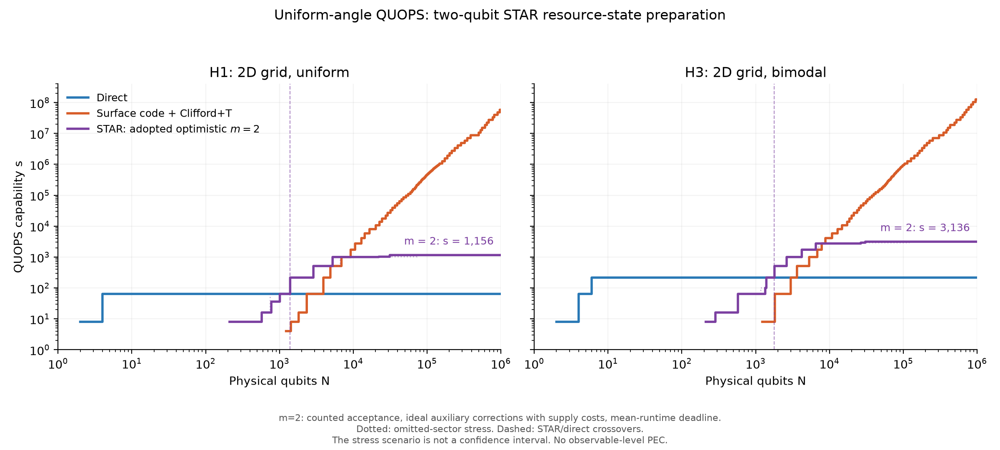

# STAR capability estimation

The main two-qubit STAR estimator implements the agreed optimistic comparison
for uniform-angle QUOPS on H1 and H3. It replaces Clifford+T synthesis and
T-state factories with angle-dependent state preparation and repeat-until-success
(RUS) teleportation. The comparators are direct execution and Clifford+T with counted sequential PBC.
The [assumption decision record](star_two_qubit_assumption_responses.md) distinguishes
implemented idealizations from unresolved factory and scheduling choices.

## Model, workload, and domain

For even width $w$, volume is $s=wL$, with $L=w$ for shallow circuits and $L=w^2$
for deep circuits. There are $R=s/2$ requested rotations. Capability is the largest
volume meeting the qubit, error, and one-week runtime criteria. A plateau is the
largest volume reached over the studied physical-qubit budgets.

H1 has $p=q=10^{-3}$; H3 has $p=10^{-3}$ and $q=10^{-6}$. CNOT, preparation,
and readout faults use $p$; H, physical rotations, and idle faults use $q$.
The counted circuits use compiled CNOT–RZ–CNOT rotations and explicit local routing.
The current tables support $k=3,5,7,9$, preparation distance $d_p=2k$, and odd
computation distances $d=3,\ldots,31$. Different physical rates, circuits, or
larger distances require new circuit inputs. The native-RZZ scenario is outside
this calibration.

The repository rotation $R_P(\theta)=e^{-i\theta P/2}$ maps to the preparation
convention $e^{i\phi P}$ with $\phi=-\theta/2$. Removing Clifford multiples of
$\pi/4$ leaves uniform residual angles in $[-\pi/8,\pi/8)$. Midpoint integration
uses 512 angles by default. RUS succeeds with probability $1/2$, doubles the
remaining angle after failure, and consumes two main states on average.

## Preparation acceptance and retained error

For an ideal transversal preparation, $\tan\phi=\tan^k\alpha$. Let $a_n$ be the
intrinsic projection weight of a sector with $n$ rotation groups and its
complement, and let $H_n$ be its counted all-orders syndrome weight. The model uses

$$
A(\phi)=\sum_n a_n(\phi)H_n,\qquad
b_1(\phi)=\frac{a_e(\phi)T_1}{A(\phi)},\qquad a_e=a_1.
$$

$T_1$ contains exactly one nonzero monitored signature in the known one-group
sector and marginalizes other zero-signature faults:

$$
T_1=\Phi_0\left[\frac{d_pp}{15(1-p)}+\frac{d_pq}{6(1-q)}\right],
\qquad \Phi_0=\prod_\ell\Pr(s_\ell=0).
$$

Its leading coefficient is $k(2p/15+q/3)$. The physical-RZ contribution $kq/3$
is retained. The known erroneous state has angle offset $\Delta$; other accepted
logical effects are assigned ideal output. This is an explicit optimistic
channel choice, not a calibration of the complete physical output.

The [Toshio circuit derivation](star_rejection_count_derivation.md) describes the
schedule and monitored signatures. Acceptance includes initialization, noisy
syndrome extraction, compiled rotations, and idles; it does not assume ideal
syndrome extraction or a common survival factor that cancels from $b_1$.

Original STAR uses the [subsystem seed and noisy expansion circuit](original_star_rejection_count_derivation.md).
Its acceptance is $A_{\rm orig}=\Pr(\bigoplus_\ell s_\ell=0)$, evaluated by a
Fourier expectation over all fault orders. The retained conditional logical-Z
error is $p_f=W_{1Z}/A_{\rm orig}$, with leading coefficient $4p/15+q/3$.
Unresolved accepted effects, including residual-syndrome decoder outcomes, are
idealized. See the [full derivation](original_star_channel_and_correction.md).

## Coherent cancellation and protocol switching

Auxiliary inverse rotations follow Toshio's transversal RUS construction with
ideal logical output. Their composition with the retained main error channel gives

$$
p_{\rm tr}=2b_1(1-b_1)\sin^2\Delta.
$$

If $\Delta$ denotes the manuscript's full $R_Z$ angle, replace this by
$\sin^2(\Delta/2)$. The old auxiliary-error term $b_1\,2p_f/(1+p_f)$ is absent.
The remaining dephasing still contributes to circuit failure. The main protocol
switches to original STAR whenever $p_{\rm tr}>p_f$.

Auxiliary corrections use the selected $k$, without original-STAR switching or
recursive coherent cancellation. For $\psi=-\Delta(\phi,k)$, their expected time is

$$
T_{\rm corr}(\psi)=\sum_{j\ge0}2^{-j}
\left[\frac{4+d}{A_T(\operatorname{fold}(2^j\psi),k)}+d\right],
$$

terminating at a Clifford residual. Thus ideal correction output does not grant
free replacement states. The implementation includes a positive geometric tail
bound after 48 rounds. In a batch of $B$ main rotations, correction time is
$2B\langle b_1(\phi)T_{\rm corr}(-\Delta(\phi,k))\rangle$, with zero correction
probability on angles switched to original STAR.

## Space, schedule, and success criterion

Both encoded models charge $2d^2$ physical qubits per tile, use the same effective
patch-cycle error fit, and use a 1 µs cycle. STAR assumes $2w$ data/routing
patches and simultaneous access for all CNOTs in a layer, which takes $2d$
cycles. These are optimistic STAR routing assumptions configured in `StarChoices`.
Each STAR injection takes $d$ cycles, with free delivery and software frame
updates. Every live data, routing, and storage patch incurs memory exposure
during preparation and RUS waits. The Clifford+T comparator absorbs CNOTs
into measurement axes and charges serial Pauli-product measurements, transformed
readouts, fast-block tiles, cold factory startup, and output buffers.
[PBC architecture](surface_architectures.md)

STAR-specific allowances remain provisional: each station reserves an unrotated
$(2d_p-1)^2$-qubit preparation patch and one distance-$d$ handoff patch. Each
attempt, including a rejected attempt, costs $4+d$ cycles. Main rotations run
in synchronized batches, with geometric preparation retries and RUS, and
auxiliary corrections are serialized. Factory growth, storage, and feasible
adaptive overlap are the remaining parts of assumption 6.

The adopted additional preparation allowance is zero. The error criterion is

$$
\mu=\mu_{\rm live\ patches}
 +2R\left\langle-\ln(1-p_{\rm step})\right\rangle\le0.5,
$$

where $p_{\rm step}$ is $p_{\rm tr}$ or $p_f$ after main switching. The effective
stochastic model uses $e^{-\mu}$ as its no-fault bound. It is not a guarantee for
the omitted physical channels.

Modeled mean runtime is compared directly with one week, matching the surface-code
baseline. For $M$ executions and $K$ machine copies, require
$K\lfloor W/\mathbb E[T]\rfloor\ge M$. There is no Markov multiplier or
subtracted deadline-failure allowance, and no deadline-tail guarantee is claimed.

## Search, outputs, and validation

The optimizer searches both workload families, all available $k$, odd distances
through 31, and $F=1,\ldots,w$ stations. It evaluates each distance's own resource
error; the original-STAR error now depends on distance, so the old distance-3
pruning bound cannot be used. Results are scoped to this finite menu. Alignment
with the surface-code distance range remains open.

| Hardware | Maximum volume | Minimum qubits | $(d,k,F)$ | Stress-test minimum qubits at the same volume |
|---|---:|---:|---|---:|
| H1 | 1,156 | 31,171 | (15, 3, 1) | 73,123 |
| H3 | 3,136 | 30,371 | (11, 3, 9) | 119,675 |

| Hardware | Direct capability at $10^4$ qubits | STAR at $10^4$ | PBC at $10^4$ | PBC at $10^6$ | Qubit budgets where STAR strictly exceeds both |
|---|---:|---:|---:|---:|---:|
| H1 | 64 | 1,000 | 512 | 45,882,712 | 1,395–11,299 |
| H3 | 216 | 2,744 | 1,728 | 123,505,992 | 1,787–11,187 |

The table includes both endpoints. In the results JSON, `star_lead_intervals_half_open`
stores the first winning budget and the first budget past the interval. PBC ties STAR
at 11,300 qubits on H1 and 11,188 on H3. The `star_crossover` field records the first
budget where STAR exceeds direct execution. The ranges use the step changes in the saved
design rows. The PBC values at fixed budgets use exact width refinement.

The omitted-sector stress test adds
$[\sum_{n\ge1}a_nH_n-a_eT_1]/A$ to the transversal error before recomputing
switching and optimizing resources. It still idealizes unmodeled original-STAR
and zero-sector effects. It is not a bound on the complete unknown channel;
switching can also change supply cost in either direction.



[Main JSON](../results/star_comparison.json) · [Comparison PDF](../figures/star_comparison.pdf)

The integration tests reproduce 114 independently saved adopted/stress designs.
Other checks cover channel composition, projection amplitudes, preparation/RUS
statistics, table provenance, finite-noise $q/3$ contributions, small exhaustive
searches, and multiple-copy deadlines.
Selected designs also passed a 2,048-angle check in the independent calculation.

## Reproduction and code map

```bash
.venv/bin/python -B scripts/package_star_inputs.py --check
.venv/bin/python -B -m pytest -q
.venv/bin/python -B scripts/make_star_comparison.py
```

Set `MPLCONFIGDIR` to a writable directory if needed. `--angle-points 1024`
increases angular resolution; `--no-sensitivity` skips sensitivity calculations.
The main figure excludes $m=1$. The script also produces separate preparation
and historical single-qubit diagnostics. Their $m=1$ channel is not recalibrated
by the two-qubit circuit calculation.

| File | Role |
|---|---|
| [config.py](../capability/config.py) | `STAR_BASELINE`, explicit `STAR_LEGACY`, and historical `STAR_SINGLE_QUBIT` |
| [star_states.py](../capability/star_states.py) | Angles, conditional channels, switching, and auxiliary RUS supply |
| [star_data.py](../capability/star_data.py) | Counted input loading and domain checks |
| [star.py](../capability/star.py) | Timing, live-patch loss, geometry, deadlines, and design search |
| [make_star_comparison.py](../scripts/make_star_comparison.py) | Saved results and figures |
| [test_star_assumptions.py](../tests/test_star_assumptions.py) | Integration and independent regression checks |
| [Circuit-input reproduction](../analysis/star_inputs.md) | Source circuits, numerical methods, and packaging |

The counted model is selected by `STAR_BASELINE`; constructing `StarChoices()`
directly retains the legacy defaults for compatibility. The counted model
rejects unsupported rates, distances, and count-scaling sensitivities explicitly.
Use `omitted_sector_stress=True` for the supported channel sensitivity.

Sources: [Toshio et al., PRX 15, 021057](https://doi.org/10.1103/PhysRevX.15.021057),
Secs. III–IV; [Akahoshi et al., arXiv:2303.13181](https://arxiv.org/abs/2303.13181),
Secs. IV and VI; and the [shared QUOPS methods](quops_direct_and_surface.md).
