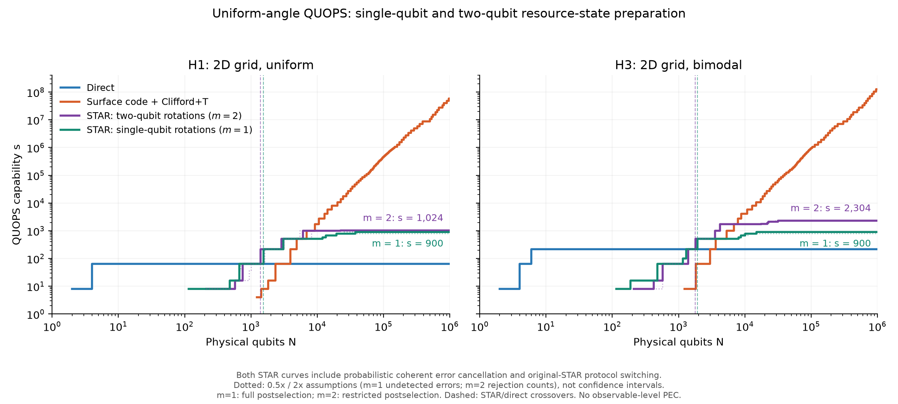

# STAR capability estimation with single-qubit and two-qubit transversal rotations

Implemented 26 October 2026 on the `star-comparison` branch, starting from `22f4fb4`
(the saved plan; the original estimator was at `36e606e`). Extended on 27 October 2026
to include the single-qubit transversal-rotation protocol.

The estimator replaces Clifford+T synthesis and T-state factories with resource-state
preparation and repeat-until-success (RUS) teleportation. It now compares **single-qubit
transversal rotations** ($m=1$, the Choi et al. protocol reviewed by Toshio et al., Sec. III A)
and **two-qubit transversal rotations** ($m=2$, Toshio et al., Sec. III B).
Both use the existing **uniform-angle QUOPS** workload on **H1 and H3**.
The original Clifford+T and direct estimators, their defaults, and their saved baseline artifacts
are unchanged.

**This is a first-pass analytical resource estimate.** The state/channel equations follow the
paper, but acceptance at finite physical noise and some layout costs are declared assumptions,
not new circuit-level simulations or measured hardware data. The results below are conditional
on those assumptions. They are not a reproduction of the paper's Hubbard-model resource estimate.

## Outputs and results

Both STAR curves include Toshio et al.'s probabilistic coherent error cancellation and
protocol switching to the original STAR preparation protocol. Consequently, the $m=1$
curve does not mean every consumed resource state was prepared with single-qubit
transversal rotations. The original protocol is used after switching and for additional
correction rotations. The assumed physical gate set remains single-qubit rotations
and Clifford operations, including CNOTs.



| Quantity | H1, $m=1$ | H1, $m=2$ | H3, $m=1$ | H3, $m=2$ |
|---|---:|---:|---:|---:|
| First qubit count exceeding direct capability | 1,534 | 1,395 | 1,926 | 1,787 |
| Capability at 1,000 physical qubits | 64 | 64 | 64 | 64 |
| Capability at 10,000 physical qubits | 512 | 1,000 | 676 | 1,728 |
| Capability at 1,000,000 physical qubits | 900 | 1,024 | 900 | 2,304 |
| Qubits needed to attain that maximum | 37,281 | 22,331 | 14,931 | 31,581 |
| Continuous size bound from resource-state errors alone | 902.37 | 1,155.12 | 929.53 | 2,361.66 |

The direct capabilities remain 64 (H1) and 216 (H3). At one million physical qubits,
Clifford+T reaches 59,319,000 and 135,796,744 respectively. All previously saved direct,
Clifford+T, and $m=2$ STAR designs retain exactly the same numerical values.
The single-qubit comparison is conditional on the assumed error coefficients below;
it does not establish a hardware-independent ranking of the protocols.

STAR reduces the initial overhead, but its residual analog-rotation errors impose a much lower
maximum circuit size for this workload. Most QUOPS angles are not very small, even after Clifford reduction.
The available discrete sizes, $w^2$ and $w^3$ for even $w$, explain the difference between the
continuous size bounds from resource-state errors and the achieved plateaus.

For $m=2$, the H1 design at the plateau uses $w=32$, data distance 13, preparation distance 10 ($k=5$), and
one ancilla patch for preparation. Its loss contributions are approximately 0.4420 from injection, 0.0322
from live patches, and 0.00123 from preparation memory. The H3 design uses $w=48$, data distance
11, preparation distance 6 ($k=3$), and 23 ancilla patches for preparation. Its corresponding losses are 0.4058, 0.0120,
and 0.08195. The deadline contribution is below $2\times10^{-6}$ in both cases.

For $m=1$, both maxima are shallow circuits with $w=30$. H1 uses data distance 17,
preparation distance 9 ($k=9$), and three ancilla patches for preparation; H3 uses data
distance 11, preparation distance 7 ($k=7$), and one such patch. Their mean runtimes are
0.538 s and 0.0901 s; Markov deadline bounds are 6.22 days and 1.04 days.
The H1 design is close to both the error threshold and the one-week deadline.

At these designs, **87.7% (H1) and 83.4% (H3) of uniformly sampled RUS angles select
the original STAR preparation protocol**. Turning off switching for the requested
rotations reduces the $m=1$ maxima to **64 and 144**. Additional rotations for
probabilistic coherent error cancellation still use original STAR in that control.
These are angle fractions, not fractions of preparation attempts or all consumed states.


Files:

- [`figures/star_comparison.png`](../figures/star_comparison.png) and
  [PDF](../figures/star_comparison.pdf): direct, Clifford+T, and Toshio STAR capability curves.
- [`figures/star_preparation.png`](../figures/star_preparation.png) and
  [PDF](../figures/star_preparation.pdf): rotation error and preparation success probability
  for both weights at $k=3$, data distance 9. Preparation distances are 3 and 6, respectively;
  this diagnostic is not a comparison at equal preparation distance. Logical errors during
  preparation are included separately in the capability estimate.
- [`figures/star_single_qubit_comparison.png`](../figures/star_single_qubit_comparison.png)
  and [PDF](../figures/star_single_qubit_comparison.pdf): expanded view of the STAR curves
  and the $m=1$ control with protocol switching disabled.
- [`results/star_comparison.json`](../results/star_comparison.json): model settings, designs,
  loss breakdowns, exact probes, crossovers, and sensitivity results.

## What changed in the code

| File | Role |
|---|---|
| [`capability/star_states.py`](../capability/star_states.py) | Angle conventions, projected resource-state formulas, conditional error, coherent cancellation, protocol switching, and an angle-resolved RUS diagnostic. |
| [`capability/star.py`](../capability/star.py) | Preparation/RUS timing, layout, error and deadline bounds, design search, and capability sweep. |
| [`capability/config.py`](../capability/config.py) | `StarChoices`, `STAR_BASELINE` ($m=2$), and `STAR_SINGLE_QUBIT` ($m=1$); original `Choices` defaults remain unchanged. |
| [`scripts/make_star_comparison.py`](../scripts/make_star_comparison.py) | Runs H1/H3 comparisons, writes JSON, and produces the figures. |
| [`tests/test_star.py`](../tests/test_star.py) | Checks state amplitudes, channel composition, stochastic timing identities, optimization, limits, and constraints. |
| [`README.md`](../README.md) | Adds the reproduction command and links to this note. |

The saved [implementation plan](star_surface_code_plan.md) remains as the planning record.
There is no standalone original-STAR capability curve in this implementation. Original injection
is used only as Toshio's large-angle switching protocol and for the rare physical correction
rotations.

Relative to original upstream commit `36e606e`, only `README.md` and `capability/config.py`
are modified pre-existing files. The STAR modules, script, tests, reports, JSON, and
figures are additions. This extension updates those additions and creates
`figures/star_single_qubit_comparison.{png,pdf}`. The workspace-root
`../star_math_derivations.md` is also updated with the new formulas and function references.

## Physical noise assumptions

H1 uses $\epsilon_{1q}=\epsilon_{2q}=10^{-3}$. H3 uses $\epsilon_{1q}=10^{-6}$ and
$\epsilon_{2q}=10^{-3}$. Preparations and measurements belong to the repository's
$\epsilon_{2q}$ rate class. The original surface-code law is retained:

$$
p_{\rm SC}(d)=0.03(p/p_{\rm th})^{(d+1)/2},\qquad
p=10^{-3},\quad p_{\rm th}=0.01\ \text{or}\ 0.015.
$$

The original code does not specify physical Pauli channels. To use the preparation formulas,
the new model assumes independent stochastic depolarizing gate faults: each nonidentity
single-qubit Pauli has probability $\epsilon_{1q}/3$, and each nonidentity two-qubit Pauli has
probability $\epsilon_{2q}/15$. These probabilities are used analytically; no decoder or syndrome
circuit is simulated.

For $k$ weight-two rotations, the modeled undetected-event probability is unchanged:

$$
u=k\left(\frac{2\epsilon_{2q}}{15}+\frac{\epsilon_{1q}}{3}\right).
$$

The first term follows the CNOT/single-qubit-rotation implementation in the paper with perfect
virtual Z rotations. The second term is the model's extension for a stochastic Z fault on the
physical rotation pulse, propagated to a ZZ error. Other first-order faults are assumed detected
or corrected as in the preparation construction. This extension, especially for H1, needs a
circuit-level check before interpreting the numbers as device predictions.

For single-qubit transversal rotations, this probability must also include errors from
initial-state preparation and syndrome measurements. Toshio et al. determine it through
circuit simulation (Sec. III A and Appendix C); there is no universal $m=1$ coefficient
to substitute for the $m=2$ expression. The estimate uses an uncalibrated exposure model:

$$
u_1=\xi k\left(n_2\frac{4\epsilon_{2q}}{15}
                 +n_1\frac{\epsilon_{1q}}{3}\right),
\qquad n_2=8,\quad n_1=3,\quad\xi=1.
$$

Four of the fifteen nonidentity two-qubit Paulis have Z on a given qubit, giving the
marginal factor $4/15$. Eight effective CNOT exposures represent up to four per data
qubit per syndrome round, for two rounds. Three one-qubit exposures represent the
rotation and two additional contributions from initialization/idling. These counts
**do not result from propagating faults through a syndrome circuit**. Boundary effects,
correlated faults, and whether an ancilla error is rejected are unresolved. A marginal
physical Z error is not automatically an undetectable logical error; treating these
exposures as the prior $u_1$ is the approximation being assessed.

`single_qubit_2q_locations`, `single_qubit_1q_locations`, and
`single_qubit_undetected_scale` expose these choices. The comparison varies $\xi$ by
0.5 and 2; these are sensitivity scenarios, not confidence intervals or rigorous bounds.
The code rejects $u\ge0.1$ as outside its leading-order approximation.

## State preparation and conditional error

The repository convention $e^{-i\theta P/2}$ is converted to the paper convention $e^{i\phi P}$
using $\phi=-\theta/2$, followed by reduction modulo $\pi/4$. Uniform QUOPS angles therefore give
uniform residual $\phi\in[-\pi/8,\pi/8]$. Numerical integration uses 512 midpoint samples of
$|\phi|$. The angle distribution is invariant under the doubled-and-folded RUS correction map.

Both weights use $d_p=mk$, with $m=1$ or 2 and $k\in\{3,5,7,9\}$.
Thus the preparation-distance menus are 3, 5, 7, 9 for $m=1$ and 6, 10, 14, 18
for $m=2$. The two families are optimized separately over these declared menus.
Odd $k$ avoids the additional even-$k$ Clifford in the projection formula.
For positive residual angle, the physical angle $\alpha$ satisfies

$$
\tan\alpha=(\tan\phi)^{1/k}.
$$

Using Eqs. (6), (7), and (11) of the published paper,

$$
a_0=\cos^{2k}\alpha+\sin^{2k}\alpha,
\qquad
a_e=\sin^2\alpha\cos^2\alpha
      (\sin^{2k-4}\alpha+\cos^{2k-4}\alpha),
$$

$$
\phi_e=-\arctan[(\tan\alpha)^{k-2}],\qquad \Delta=\phi_e-\phi.
$$

Negative angles use the corresponding sign symmetry. The conditional bad-state weight is

$$
b=\frac{u a_e}{(1-u)a_0+u a_e}.
$$

For $m=2$, the implemented finite-noise preparation success model is

$$
a=h[(1-u)a_0+u a_e],\qquad
h=(1-\epsilon_{2q})^{24d_p\eta}
  (1-\epsilon_{1q})^{8d_p\eta},
$$

where $\eta=1$ by default. The effective rejection counts $24d_p$ and $8d_p$ represent a
selectively postselected strip. **They are declared modeling inputs, not counts extracted from a
compiled syndrome circuit or a fit to the paper's figures.** The multiplier $\eta$ is varied in
the comparison. It changes yield and scheduling, not the conditional first-order channel in this
factorized approximation.

The default $m=1$ configuration uses full postselection as in the Choi protocol:

$$
h_{\rm full}=(1-\epsilon_{2q})^{8d_p^2\eta}
             (1-\epsilon_{1q})^{4d_p^2\eta},\qquad
a=h_{\rm full}[(1-u_1)a_0+u_1a_e].
$$

These quadratic counts are also declared assumptions. Both families can select
`postselection='full'` or `'strip'`; the latter represents Toshio's restricted
postselection region. A separate $m=1$ sweep with restricted postselection is saved
to distinguish this choice from the rotation weight itself.

Toshio's probabilistic coherent error cancellation applies an inverse correction with probability $b$.
For an ideal correction its composed channel has Pauli error

$$
p_c=2b(1-b)\sin^2\Delta.
$$

The model adds $b\,2p_f/(1+p_f)$ as a bound on errors in implementing that correction
by RUS using original STAR states. This does not model all other second-order mechanisms.

For protocol switching, the original preparation protocol uses the original paper's CNOT/Rz circuit with
$p_f=9\max(\epsilon_{1q},\epsilon_{2q})/15$. Its published uniform-noise coefficient is retained
conservatively for H3 instead of inventing a precise bimodal coefficient. Its yield surrogate is

$$
a_f=(1-\epsilon_{2q})^{8d^2\eta}(1-\epsilon_{1q})^{4d^2\eta}.
$$

The original protocol is selected at angles where its rotation error is smaller. Additional correction
rotations also use it. There are no synthesized T gates or distilled T states in this branch.
Observable-level probabilistic error cancellation (PEC) and its shot overhead are excluded.

## Background preparation errors and layout

An accepted preparation additionally incurs

$$
\ell_p=4[-\ln(1-p_{\rm SC}(d_{\rm fit}))],\qquad
d_{\rm fit}=\begin{cases}d_p,&d_p\text{ odd},\\d_p-1,&d_p\text{ even}.\end{cases}
$$

This is an assumed contribution from logical errors during preparation, configurable
through the existing code parameter `preparation_floor_scale`.
The actual odd distance is used for $m=1$; the next lower odd distance is used for $m=2$.
This assumed contribution is not a fitted postselected-state error rate. It is charged to
accepted resource states, including correction states, rather than to rejected attempts.

The data and routing layout retains the existing default of $2w$ rotated patches. The estimator
adds $F$ unrotated ancilla patches for preparation, each with $(2d_p-1)^2$ physical qubits,
and $F$ rotated ancilla patches for storage and transfer, each with $2d^2$ qubits. Thus

$$
N_{\rm copy}=2d^2(\lceil t_{\rm data}w\rceil+F)+F(2d_p-1)^2,
\qquad t_{\rm data}=2.
$$

No preparation space is assumed free. All data, routing, and storage patches accrue the existing
logical error rate throughout the run. The small preparation patches are reset on rejection and
their accepted-state exposure is accounted for by $\ell_p$ above. Preparation-to-storage code
deformation and delivery are charged but not physically compiled.

## Stochastic schedule

Rotations are scheduled in groups of at most $F$. Unfinished rotations advance together
through RUS rounds. Each retries preparation until an accepted state is available.
Once all unfinished rotations have states, their teleportations execute together.
The next group starts after all rotations in this group finish. This explicitly models
waiting for the slowest parallel RUS process and sharing ancilla patches for preparation.

The preparation trial duration is $4+d$ cycles: the paper's approximately four-cycle attempt
plus a declared $d$-cycle growth allowance. Growth is charged even to rejected attempts, a
conservative scheduling choice. Each teleportation additionally receives three $d$-cycle steps:
one for delivery, one for consumption, and one for Clifford operations. These costs are separately
configurable. Additional rotations for probabilistic coherent error cancellation are serialized;
their preparation, RUS, and memory costs are included.

For $B$ parallel rotations, the expected total number of preparation trial rounds is

$$
\sum_{j\ge0}\sum_{g\ge0}
\left[1-\left(1-2^{-j}\mathbb E_\phi[(1-a(\phi))^g]\right)^B\right].
$$

The expected RUS-round count is

$$
\sum_{j\ge0}[1-(1-2^{-j})^B].
$$

These formulas follow from geometric preparation retries and independent equiprobable RUS
outcomes. Angle correlations across successive RUS rounds do not obstruct calculation of the
expected total duration: expectation is additive, and each round has the same marginal angle
distribution. The angle average is taken inside the preparation survival probability, not by
substituting an average acceptance into a geometric distribution.

Positive summation tails are bounded and their upper bounds added. For extremely low acceptance
requiring more than 100,000 preparation terms, the integration uses the conservative serial
upper bound $2B\mathbb E[1/a]$. Timing-aware pruning also rejects designs that cannot meet the
deadline even with unlimited ancilla patches for preparation.

The existing CNOT schedule is retained: by default, a random-pairing layer takes $2d$ cycles,
assuming parallel long-range lattice surgery without congestion. `cnot_layer='serial'` remains
available. As in the original estimator, the complete 2D routing layout is not compiled.

## Success criterion, deadline, and search

The estimator accumulates expected log loss from live-patch cycles and resource errors. Uniform
angles make the expected primary resource loss per completed rotation twice its angle-averaged
single-teleportation loss. Cancellation-resource memory is added separately.

Rather than claiming independence between total runtime and errors, it uses Jensen's inequality
within the effective stochastic model:

$$
\overline q=\mathbb E[e^{-L_{\rm path}}]\ge e^{-\mathbb E[L_{\rm path}]}.
$$

Expected runtime alone does not guarantee the one-week deadline. With
$\delta=10^{-6}$ per execution, Markov's inequality gives a conservative deadline
$T_{\rm bound}=\mathbb E[T]/\delta$. The returned success bound is

$$
q_{\rm lower}=\max(0,e^{-\mathbb E[L_{\rm path}]}-\delta).
$$

A design passes when $q_{\rm lower}\ge e^{-1/2}$ and enough copies fit the requested executions
into the week using $T_{\rm bound}$. JSON distinguishes `run_seconds` (the mean) from
`deadline_seconds` (the bound); the latter is intentionally very loose. For multiple executions,
$\delta$ is a per-execution deadline failure budget, not a guarantee that every shot succeeds.
These inequalities do not convert the approximate physical injection model into a rigorous
hardware guarantee.

For each selected weight $m$, the optimizer searches every declared $k$, odd data distance
$3\le d\le31$, and number of ancilla patches for preparation
$1\le F\le w$, with valid area, error, and timing lower-bound pruning. All even widths below the
size bound from resource-state errors are evaluated. It does not rely on the old estimator's width-monotonicity
shortcut. Results are exact over this declared design menu, subject to angle quadrature and the
stated physical-model approximations.

## Validation and sensitivity

- The full test suite passes: **76 tests**. Tests compare projected amplitudes directly, compose the
  correction channels on a density matrix, check analytical geometric/order-statistic identities,
  and compare the pruned optimizer with an unpruned small search.
- The new $m=1$ tests also project independently evolved state vectors onto a small stabilizer
  code, count the Pauli marginal used by the exposure approximation, check odd preparation
  distance/area, and compare optimized results against a complete small design enumeration.
- All old direct, Clifford+T, and $m=2$ designs were compared with the previously generated
  JSON and match exactly on every pre-existing field.
- Doubling midpoint quadrature from 512 to 1,024 points changes no selected $m=1$
  minimum-qubit design: all 19 designs for each hardware class agree. The size bounds at
  1,024 points are 902.36917 (H1) and 929.52920 (H3).
- The earlier $m=2$ quadrature check also changed no selected minimum-qubit design.
  Its size bounds changed from 1,155.12153 to 1,155.12098 (H1) and
  from 2,361.65641 to 2,361.65565 (H3).
- For $m=2$, multiplying the assumed rejection counts by 0.5 or 2 leaves both plateau sizes unchanged.
  H1 needs 22,331 or 44,000 qubits to attain its plateau; H3 needs 29,040 or 31,944.
  Dotted figure curves show these scenarios, not statistical confidence intervals.
- For $m=2$, setting the preparation-memory multiplier to 0 or 2 changes the H1 plateau to 1,156
  or 1,024 and the H3 plateau to 2,744 or 1,936. These scenarios are stored in JSON. This is an
  important source of model uncertainty in addition to the injection-channel assumptions.
- For $m=1$, scaling the undetected-error approximation by 0.5 or 2 gives maxima of
  900 or 784 on both H1 and H3. These scenarios are the green dotted curves.
- For $m=1$, scaling rejection counts by 0.5 or 2 gives maxima of 900/784 (H1) and
  900/900 (H3). Setting the preparation-memory multiplier to 0 or 2 leaves both maxima
  at 900 but changes the required physical qubits.
- With restricted postselection, $m=1$ still reaches 900 on both hardware classes;
  H1 needs 36,414 qubits, and H3 14,931. Disabling switching for requested rotations
  instead gives 64 (H1) and 144 (H3). The JSON saves both controls.

The estimate omits a full syndrome-level/decoder calibration, systematic analog-control errors,
unmodeled higher-order injection faults, compiled routing congestion, and precise deformation
circuits between the preparation and data layouts. The original protocol retains its
uniform-noise coefficient on H3 as a conservative modeling choice.
The model covers weights one and two with odd $k$ and the repository's existing uniform-angle QUOPS
ensembles; small-angle Hamiltonian workloads would require separate circuits and accuracy goals.

## Reproduce or vary

From the repository root:

```bash
.venv/bin/python -m pytest -q
.venv/bin/python scripts/make_star_comparison.py
```

If the user cache directory is not writable, set a writable Matplotlib cache for that command:

```bash
MPLCONFIGDIR=/tmp/capability-plateau-mpl .venv/bin/python scripts/make_star_comparison.py
```

Use `--angle-points 1024` for finer integration or `--no-sensitivity` to skip the 0.5x/2x
and preparation-memory variations. The postselection and switching controls are always
computed. Both flags regenerate the same named artifacts. Other choices can be varied through
`dataclasses.replace(STAR_BASELINE, ...)` and passed to `star.sweep` or `star.min_qubits`.

For the single-qubit protocol, pass `STAR_SINGLE_QUBIT` from `capability.config` instead:

```python
from capability import star
from capability.config import BASELINE, HARDWARE, STAR_SINGLE_QUBIT
rows = star.sweep(HARDWARE['H1'], BASELINE, STAR_SINGLE_QUBIT)
```

The existing JSON key `star` remains $m=2$; `star_single_qubit` contains $m=1$.
Each design records `rotation_weight`, `postselection`, and `preparation_distance`.
Top-level `star_single_qubit_choices` records every assumption used for $m=1$.
All figures and the JSON are regenerated by the same command above.

## References

- H. Choi et al., [Fault Tolerant Non-Clifford State Preparation for Arbitrary Rotations](https://arxiv.org/abs/2303.17380).
  The implemented single-qubit projection follows Toshio et al.'s review of this protocol;
  it does not implement Choi et al.'s additional rotation-synthesis constructions.

- R. Toshio et al., [Practical Quantum Advantage on Partially Fault-Tolerant Quantum Computer,
  Phys. Rev. X 15, 021057 (2025)](https://doi.org/10.1103/PhysRevX.15.021057): Sec. III and
  Eqs. (6), (7), (11)–(13) for preparation; Sec. IV and Eqs. (21)–(25) for cancellation and RUS;
  Sec. IV D for protocol switching. The implementation uses the full angle-dependent formulas,
  not a constant small-angle prefactor copied from the paper's native-gate examples.
- Y. Akahoshi et al., [arXiv:2303.13181](https://arxiv.org/abs/2303.13181): Sec. IV D,
  Fig. 14 upper circuit, for the $9p/15$ CNOT/Rz coefficient of original STAR preparation.
- [Existing QUOPS methods note](quops_direct_and_surface.md): workload, hardware classes,
  surface-code law, baseline scheduling, and success criterion.
